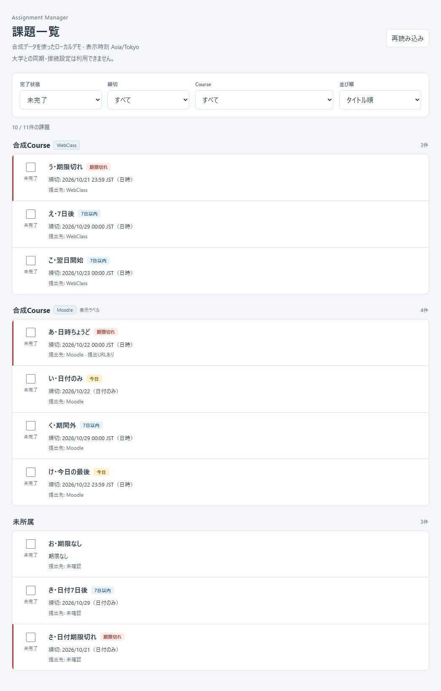

# Phase Web-2: Browser UI + Completion API

実施日: 2026-10-22（Asia/Tokyo）

**判定: Ready for Web-3。** 合成SQLite専用・127.0.0.1限定で、Browser一覧、
Course/締切/完了filter、sort、明示completion PUT、reload/restart後の保持を実装・検証した。
これは次Phaseへの着手判定であり、公開運用可能という判定ではない。Web-3は実装していない。

## 1. Changed files

| Files | Change |
| --- | --- |
| crates/application/src/runtime.rs / local_worker.rs | set_completionの公開口とlocal worker requestを加算 |
| crates/application/src/runtime_tests.rs | reply喪失、再set、restart、network不実行、sync中の明示set保持 |
| crates/web-server/src/routes.rs / requests.rs / dto.rs / error.rs / state.rs | completion PUT、厳格な入力・unsafe method検証、固定error、commit acknowledgement |
| crates/web-server/src/assets.rs（新規） / lib.rs / main.rs | embedded static allowlist、Browser URL、Web-2表示 |
| crates/web-server/tests/http_poc.rs | HTTP完了変更、永続化、再送、rollback、security、static serving tests |
| crates/web-server/Cargo.toml / Cargo.lock | 既存transitive rusqliteをtest用直接依存へ追加。version/checksum変更なし |
| frontend/app.js / settings_view.js | desktop entrypointとinvoke注入へ整理 |
| frontend/list_view.js（新規） / list_tasks.js | 既存DOM表示を共通factoryへ移動、共通controller・query generation・write recovery |
| frontend/http_api.js / tauri_api.js / web_app.js / web.html（新規） | 明示transport分離、Web専用HTML/entrypoint |
| frontend/presentation.js | Web timezone指定を加算、固定通信エラー・結果不明message |
| tests/web_frontend.test.mjs（新規） | HTTP adapter、controller、JST、DOM、desktop adapter回帰 |
| README.md / crates/web-server/README.md / crates/application/README.md | 起動・API・application契約を更新 |
| docs/FRONTEND-INTEGRATION.md（新規） | entrypoint、再利用、競合制御、復旧、配信説明 |
| docs/PHASE-WEB-2.md / phase-web-2-smoke.png（新規） | 本報告と実Browser画面 |

root core、DB schema v3、Tauri Rust commands/DTO/config、macOS bridge、Swift shell、
frontend/index.html、styles.css、settings.js、sync.jsは変更していない。

## 2. Architecture

```text
Browser (web.html → web_app.js)
  → http_api.js → same-origin GET / PUT
  → Axum / Web transport DTO → one PocState / ApplicationHandle
  → bounded local worker → core SqliteStore → synthetic SQLite v3

Tauri (index.html → app.js)
  → tauri_api.js → existing invoke commands → same shared application
```

Web-1のsynthetic directory所有権・marker/reparse検証、readiness query後のbind、
受付停止→HTTP drain→worker shutdownの順序、server clock契約は維持した。
Connection/workerをHTTP handlerへ渡さず、requestごとのruntimeを作らない。

## 3. HTTP transport

- GET /api/v1/assignmentsのquery enum/default、CourseId、totalCount、safe DTOを保持。
- PUT /api/v1/assignments/{id}/completionを追加。bodyはcompletionだけ。
- HTTP toggle、settings、sync endpointは作っていない。
- adapterは固定relative URL、URLSearchParams、same-origin、credentials omit、no-store、
  redirect rejection、10秒timeoutを使用し、JSON/type/shapeを確認する。
- Web module graphはTauriを参照しない。Tauriにfetch経路・HTTP fallbackはない。

## 4. Frontend reuse

既存app.jsの一覧DOM処理をlist_view.jsへ移動し、両entrypointから利用する。
presentation.jsのquery defaults、filter/sort request、CourseId grouping、status表示、
submission label、empty/count表示とstyles.cssを再利用した。Rustのfilter/sortをJSへ複製していない。
settings/syncはdesktopに残し、Webにはボタン・設定入力・startup sync UIを含めない。

createListTaskRunnerでtab内の処理順を保ち、query generationで古いGET結果/失敗を破棄する。
通信中のfilter変更を記録し、保存後はその時点の最新条件をqueryする。
checkboxは同期的にpendingになり、再取得で確認できるまで全checkboxを一時停止する。
title/Course等はtextContentで描画し、HTMLとして挿入しない。

## 5. Completion API

```text
PUT desired completion
  → ApplicationHandle::set_completion(id, desired)
  → LocalWorker::SetCompletion
  → SqliteStore::set_completion(&AssignmentId, CompletionState) -> Result<(), PersistenceError>
  → SQLite commit → { id, completion }
```

実際のcore signatureを確認して直接呼んだ。read→toggleでsetを模倣していない。
同一状態はupdated_atも不変で、再PUTや成功response破棄後の再送でも反転しない。
desktop toggle、user-owned completion、source sync後の保持を維持した。

PUT成功後のGET失敗は「保存済み・一覧更新失敗」。PUT応答の通信/timeout/body/shape失敗や
5xxは「結果不明」とし、未保存と断定しない。全件GETで対象の実状態を確認してから現在条件を再取得する。
未確認の間はcheckboxを停止し、反対状態への補償toggleや自動write retryを行わない。
明示4xx拒否は固定の拒否messageにし、reloadで状態を更新する。

## 6. Date/time handling

serverはUTCを一度sampleし、同じinstantから+09:00のQueryClockとevaluatedAtを作る。
timeZoneはAsia/Tokyo。DateTimeはUTC RFC3339 Zの小数秒を保持して返し、WebはIntlでJST表示する。
DateOnlyはcalendar stringを直接整形し、UTC Dateへ変換しない。
期限切れ/今日/7日以内はRust statusが正本で、JSは期限判定を追加していない。
desktopのOS local表示は維持。Node child processのTokyo/Los Angeles/UTCでもWeb表示が一致した。

## 7. Security

127.0.0.1だけにbindし、public bind/DB選択のCLI・環境変数機能はない。
Hostは固定loopback host/port、Originは実Hostと完全一致したhttp originだけ。
cross-siteを拒否し、PUTにはOrigin、application/json、X-Assignment-Manager: web-2を必須にした。
Fetch Metadataがあればsame-originだけを許可し、navigate/no-cors等や重複headerを拒否する。
CLIはMetadataを省略できるがOrigin・専用headerは省略できない。
これはPoC専用CSRF対策であり、本番Web認証・authorizationの代替ではない。

PUT bodyは1024 bytesまで。unknown/duplicate field、不正JSON/enum/IDは400、unknown IDは404、
wrong Content-Typeは415、oversized bodyは413。既存500/503分類、Retry-Afterと固定errorを保持した。
DB path、SQL/cause、入力body、synthetic secret/source markerをerror/responseへ出さない。

HTMLと6個のCSS/JSをcompile-time allowlistで埋め込み、faviconだけ204を返す。
filesystem path読取・directory listingはなく、traversal、DB、source/config/lockfile、desktop JSは404。
全応答にno-store、nosniff、CSP、no-referrer、X-Frame-Options DENY、CORP same-origin。
CORS許可headerを返さず、CDN依存もない。memory settings/NoCredentials/DisabledNetworkBackendは維持し、
real credential・実大学データ・大学HTTP client・startup syncをWebから使用する経路はない。

## 8. Automated tests

| Target | Result / evidence |
| --- | --- |
| Web Rust unit | 3 PASS（固定error、inert backend、graceful drain） |
| Web HTTP integration | 15 PASS（Web-1の10件を保持し5件加算） |
| Web doctests | 0件 |
| frontend Node | 43 PASS（既存30 + 新規13） |
| Web/application fmt・clippy | PASS、all-targets/all-features、-D warnings |

HTTP integrationでcompleted/incomplete、同一PUT、response破棄→同一PUT再送、GET→PUT→GET、
completed filter、restart、同一setのtimestamp不変、v3全6table/source identityの維持を確認した。
異常body/ID/header、413/415/404、Host/Origin/Metadata拒否、safe rollback/error、static allowlistも確認した。
applicationではreply破棄後のcommit、sync中のset、configured mock backend呼出し0回を確認した。

Nodeではquery serialization/default/全filter/sort、desired-state PUT/re-PUT、safe errors、
network/timeout/response failure、save成功→GET失敗、pending重複防止、filter変更/古いGET、
unknown結果の全件照会・失敗中停止・復旧、JST/DateOnly/OS timezone非依存、literal XSS title、
Web module graphのTauri非参照、desktop invoke command/argument維持を確認した。

## 9. Existing regression tests

| Target | Unit / doc tests | fmt --check | clippy all-targets/all-features -D warnings |
| --- | --- | --- | --- |
| root core | 312 / 11 PASS | PASS | PASS |
| shared application | 32 / 2 PASS | PASS | PASS |
| Tauri Rust | 18 PASS | PASS | PASS |
| macOS bridge Rust | 18 / 0 PASS | PASS | PASS |
| Web server | 3 unit + 15 integration / 0 PASS | PASS | PASS |

全Cargo test/clippyを--locked --offlineで実行した。最初の制限環境ではWeb-1既存の一時DB作成が失敗したため、
通常Windows権限で再実行して全PASSを確認した。防御を弱めるproduction変更はしていない。
incremental cacheのhard-link警告はcopy fallbackの環境警告で、build/test/checkの失敗ではない。
テスト失敗の未解決項目はない。

再現コマンド（各manifestについてtest/fmt/clippyを実行）:

```powershell
cargo test --manifest-path crates/web-server/Cargo.toml --locked --offline
cargo fmt --manifest-path crates/web-server/Cargo.toml --check
cargo clippy --manifest-path crates/web-server/Cargo.toml --locked --offline --all-targets --all-features -- -D warnings
node --test tests/frontend.test.mjs tests/settings.test.mjs tests/sync.test.mjs tests/web_frontend.test.mjs
```

他manifestはCargo.toml、crates/application/Cargo.toml、src-tauri/Cargo.toml、crates/macos-bridge/Cargo.toml。

## 10. Windows build

`cargo build --manifest-path src-tauri/Cargo.toml --locked --offline --features custom-protocol` PASS。
Web serverもWindows MSVCでbuild/runした。Tauriの既存Rust commandsとconfigは維持した。
通常desktopアプリは実DB/credentialへ触れないため起動していない。desktop adapterはNode、
Rust側はunit testsとWindows buildで確認した。

macOS Xcode/Swift native build・tests、Keychain実機確認はWindowsでは実施できないため未実施。
macOS bridge Rust PASSをSwift/native PASSとして扱わない。

## 11. Manual smoke

Windows上のCodex内蔵Chromium Browserで、合成DBだけを使用した。
serverは指定command `cargo run --manifest-path crates/web-server/Cargo.toml --locked`で起動できた。

| Check | Result |
| --- | --- |
| `/`の課題一覧・Course grouping・件数 | PASS、11件中未完了10件、同名Course 2 group + 未所属 |
| completion all/incomplete/completed | PASS |
| deadline all/overdue/today/within_seven_days | PASS |
| course all/unassigned/個別Course | PASS |
| deadline/course/title sort | PASS、group内はserver順 |
| checkbox completed/incomplete | PASS、「い・日付のみ」を双方向に変更 |
| 未完了filterで完了にすると消える | PASS、10→9件 |
| 完了済みfilterで再表示 | PASS、1→2件、checked表示 |
| Browser reload後の保持 | PASS、完了済み2件を維持 |
| Ctrl+C→server restart後の保持 | PASS、同じ課題が完了済みで再表示 |
| 日本語title/DateOnly/JST・badge | PASS |
| empty state/reset | PASS、未所属+今日で0件、resetで復旧 |
| Settings/Syncの誤操作防止 | PASS、Web DOMに未対応の操作を含めない |
| Browser console | 通常の最終表示時error/warn 0件 |
| server停止時のGET失敗 | 前回一覧を保持しcheckbox停止、error表示を確認 |
| listener | Get-NetTCPConnectionで127.0.0.1:3000のみ確認 |

操作後に「い・日付のみ」を未完了へ戻した。合成DBを再seed・削除していない。
smoke終了後にserverを停止し、port 3000のlistenerが0件であることも確認した。
通常のUI動作/永続化は実Browserで確認し、response喪失とsave成功後GET失敗の厳密な順序は
deterministic Node/Rust testsで確認した。実大学との通信は行っていない。



## 12. Remaining limitations

- 未認証のloopback synthetic PoC。実credential、実大学データ、公開・tunnel・reverse proxy運用は対象外。
- 認証/authorization、credential暗号化、大学同期、PWA/offline/SW、学期/submission state等は未実装。
- WebはAsia/Tokyo固定、fixtureの締切は固定日付。実行日によってbadgeは変わる。
- assetはcompile-time埋込のため変更後のrebuildが必要。
- tab間の自動更新・競合versionはない。対立する明示setはDB commit順で決まり、他tab変更はreloadで確認する。
- 通信結果を確認できない間は全checkboxを止める。request timeoutはrollbackを意味しない。
- native macOS実機と通常desktop UIの再確認は上記の通り未実施。

**Ready for Web-3**
