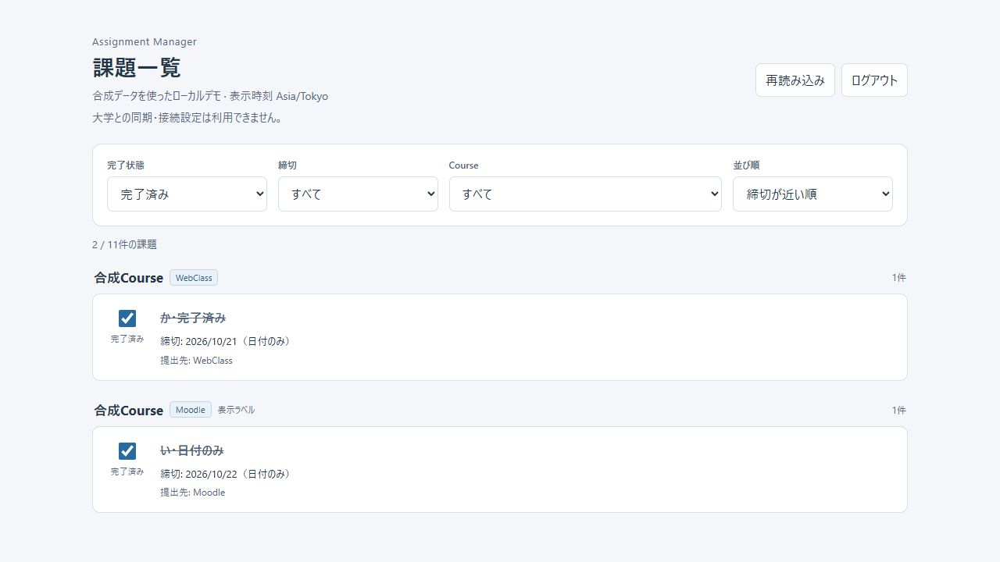
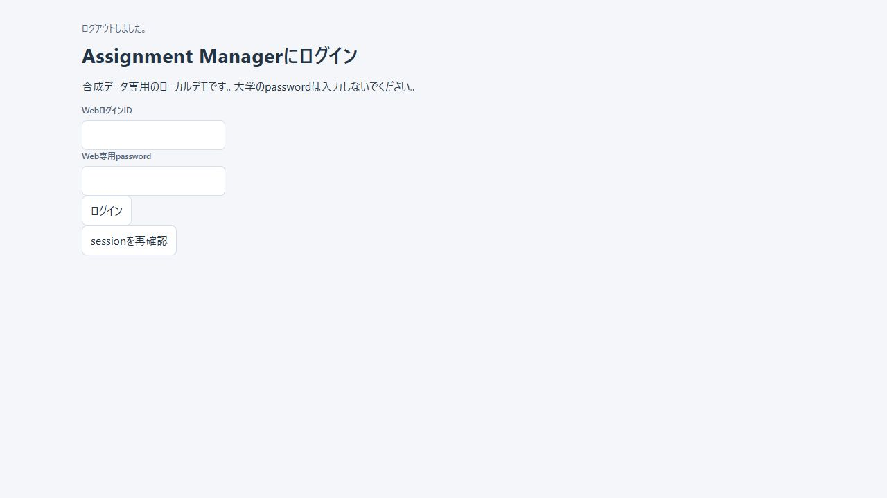

# Phase Web-3A: Authentication, Session & User Isolation

実施日: 2026-10-22（Asia/Tokyo）。Branch: feature/web-migration。

**判定: Ready for Web-3B。** 対象は合成データ・単一account・127.0.0.1限定のlocal PoC。
インターネット公開を許可する判定ではない。Web-3Bは実装していない。

指定のWeb-0/Web-2/frontend資料、Web server全module、application runtime/settings/credentials/
sync_workerと関連テストを確認した。root core/schema v3、application public API、Tauri commands、
bridge/Swift nativeは変更していない。

## 1. Authentication architecture

Web専用LocalPasswordProviderが内部UserIdを確定し、AuthServiceがsessionを管理する。
OIDCは未実装だが、providerのcredential検証とCookie/session所有権は別責務。
RustCrypto Argon2id v19、19 MiB/t=2/p=1、random 16-byte salt、PHC verifierを採用。
password/hash/SQL/causeをresponseへ返さず、unknown/disabled/wrong passwordは固定401。
hash/verify/control SQLiteはspawn_blocking、login hashは同時1件に制限する。
詳細・参照仕様は[認証設計](WEB-AUTHENTICATION.md)。

## 2. Account bootstrap

`cargo run --manifest-path crates/web-server/Cargo.toml --locked -- bootstrap-admin`。
terminalで専用ID、非表示password、非表示確認入力を受ける。password CLI引数/env指定はない。
公開signup/default account/auth bypassを作らず、未作成ならserverはbootstrap_requiredで停止する。
single account constraintとtransactionで重複/失敗時の不完全行を拒否。
UserIdは大学identityと独立した256-bit random ID。
Web control DBはweb-control.db/user_version=1。課題DB v3から分離した。
OS exclusive file lockでserverの二重起動・稼働中bootstrapを拒否する。

## 3. Session model

Cookie tokenは256-bit CSPRNG、server保存はSHA-256 hashだけ。
HttpOnly/SameSite=Strict/Path=/、Domainなし、Max-Age=12時間。
HTTP loopback専用CookieのためSecureなし。本番HTTPS経路/public flagは提供していない。
productionの__Host-/Secure/Path=/要件は設計に明記し、このCookieを公開用に切替できない。
idle 30分、absolute 12時間、login rotation、logout server失効、replay拒否を実装。
reloadはsessionを利用できる。server restartではpersisted sessionを全削除して再loginを要求する。
accountと課題completionはrestartでも保持する。rate-limit timestampも維持する。

## 4. UserId / TenantRuntime ownership

起動時のownerと1つのApplicationHandleをimmutable TenantRuntimeへ束縛。
認証済みUserIdのexact equalityを確認した場合だけhandleへ到達する。
requestからpath/tenant/credential ownerを選択しない。globalなcurrent-user可変stateはない。
3 workerをrequestごとに作らず再利用する。汎用multi-user registryは今回不要と判断した。

## 5. Authorization

GET assignments/PUT completion/session/logoutをCookie認証必須にした。
未認証・期限切れ・logout済みは401。既存sessionのdisabled account/owner不一致は403。
ownerが決まる前に課題query/setを実行しない。HTTPからsettings/syncは呼べない。
healthとembedded static assetsだけは認証不要。

## 6. CSRF

mutationはexact Host/Origin、JSON、web-3a custom header、Fetch Metadataを検証。
loginはこれらでlogin CSRFを防ぎ、logout/PUTは別途session-bound random CSRFを必須とする。
CSRFはconstant-time比較、重複/欠落/不一致/他session tokenを拒否。logoutで一緒に失効する。
HTTP adapterはcredentials: same-origin、mode: same-origin、redirect: error、no-store。
CLIはMetadata省略可能だがOrigin/JSON/custom header/認証・CSRFは省略不可。
CORS許可なし、旧web-2 headerだけでは通らない。

## 7. Browser UI

session確認→login form→login成功後一覧→logoutでDOM消去。
401/403もloginへ戻る。passwordは送信開始直後に入力を消去し、state/storageへ保持しない。
HttpOnly CookieをJSへ返さず、CSRFのみadapter memoryへ保存。
view/model disposalとgenerationでlogout後の古いGET/body/PUTによる復活を防ぐ。
logoutの通信失敗時は一覧を隠したまま、CSRFを再取得してlogoutを再試行できる。
textContent、全filter/sort、completionの明示set/結果不明時の照合、Tauri adapterを維持。

## 8. Security boundaries

NoCredentials / DisabledNetworkBackend / MemorySettingsを維持。大学HTTP、実Keychain、
大学password、Moodle URL保存、sync endpoint、vaultは追加していない。
body 1024 bytes、strict JSON/query、query長制限、固定error、password-safe logging。
全応答のno-store/CSP/nosniff/no-referrer/frame拒否/CORPとstatic allowlistを維持。
loginは全ID合計5試行/60秒 (成功含む)、同時hash 1件、超過429 + Retry-After: 60。
実データ・real credentialを一切使わず、127.0.0.1:3000だけで検証した。

## 9. Automated tests

| Target | Result |
| --- | --- |
| Web unit | 3 PASS (fixed error、inert backend、authenticated graceful drain) |
| 新規auth HTTP integration | 11 PASS |
| Web-2 HTTP regression | 15 PASS |
| Frontend Node | 51 PASS (既存43 + 認証8) |
| Web doctests | 0件 |

auth integrationはbootstrap成功/重複/rollback、random salt/PHC/plaintext非保存、独立version、
未作成fail closed、二重server拒否、login成功/失敗/unknown/disabled、未認証GET/PUT401、
Cookie属性/hash-only保存、rotation、reload、logout/replay、idle/absolute期限、restart失効、
CSRF欠落/不一致/別session/重複、Origin/Metadata/JSON/body上限、不正入力、global rate limitと
restart後のlimit保持、owner不一致403、request ownership選択拒否、課題DB不変を検証する。

Nodeはsession確認、login UI/成功後GET、入力即時clear/storage非保持、CSRF/Cookie fetch、
401/403、失効、logout DOM消去、固定errorと復旧、logout失敗再試行、古いGET/進行中PUT/response body decoding抑止を検証。
既存completion/filter/sort/JST/XSS/transport graph/Tauri invoke回帰も保持する。

## 10. Regression tests

| Manifest | Unit / doc | fmt --check | clippy all-targets/all-features -D warnings |
| --- | --- | --- | --- |
| root core | 312 / 11 PASS | PASS | PASS |
| application | 32 / 2 PASS | PASS | PASS |
| src-tauri | 18 PASS | PASS | PASS |
| macos-bridge | 18 / 0 PASS | PASS | PASS |
| web-server | 3 + 11 + 15 / 0 PASS | PASS | PASS |

Cargo test/clippyは--locked --offlineで実行。初回のみ新規auth依存をcrates.ioから取得した。
Windows制限環境では既存PoCのtemp DB作成が失敗したため、通常権限でテストを実行してPASS。
incremental cacheのhard-link失敗はcopy fallbackの環境警告で、未解決のtest/clippy失敗ではない。
Windows `cargo build --manifest-path src-tauri/Cargo.toml --locked --offline --features custom-protocol` PASS。
macOS native/Xcode/Swift build・tests/Keychain実機はWindowsでは未検証。

再現command (各manifestでtest/fmt/clippy):

```powershell
cargo test --manifest-path crates/web-server/Cargo.toml --locked --offline
cargo fmt --manifest-path crates/web-server/Cargo.toml --check
cargo clippy --manifest-path crates/web-server/Cargo.toml --locked --offline --all-targets --all-features -- -D warnings
node --test tests/frontend.test.mjs tests/settings.test.mjs tests/sync.test.mjs tests/web_frontend.test.mjs
```

## 11. Manual smoke

Windows上のCodex内蔵Chromiumとlocal HTTP clientを使用。すべてsyntheticデータ。

| Check | Observed result |
| --- | --- |
| bootstrap CLI | PASS。Web専用smoke accountを新規作成、2回のpassword入力がterminal出力に現れない |
| 未ログイン一覧 | PASS。local HTTP GET 401、Browserはsession確認からlogin画面 |
| login成功 | PASS。login後10/11件の課題を表示 |
| filter/sort | PASS。all/completed、today、unassigned、title/course sort |
| completion | PASS。「い・日付のみ」を完了へ変更し、保存/再取得messageとcheckedを確認 |
| reload | PASS。ログイン維持、completed filterで2件・変更済み課題を確認 |
| server restart | PASS。旧Browser Cookieは401でlogin画面へ。再login後もcompletionは保持 |
| logout | PASS。login画面へ戻り、課題rows/件数/Course候補を消去 |
| Cookie replay | PASS。local HTTP login→logout 200→旧Cookie GET 401 |
| wrong password連続 | PASS。先行成功1回を含むwindow内で誤入力4回401、その後429、Retry-After=60 |
| rate-limit UI | PASS。「ログイン試行が多すぎます。60秒待ってください。」とpassword空欄を確認 |
| loopback listen | PASS。Get-NetTCPConnectionは127.0.0.1:3000だけ |
| Browser console | 正常login/list/reload時error/warn 0。意図的401/429は期待したHTTP応答 |

smoke後「い・日付のみ」を未完了へ戻した。synthetic課題を再seed/削除していない。
smoke account/control DBはgitignored target/web-poc内だけに残り、sourceへpasswordを保存していない。
同一directoryに実accountを自動上書きする運用は行わない。
旧GET/PUTの厳密なrace、30分/12時間境界はdeterministic Node/Rust testsで検証した。




## 12. Remaining limitations

- 本番HTTPS/Secure Cookie配信、proxy trust、deployment secret/ACL/backup/restore管理は未実装。
- single account、local processのみ。一般signup/reset email/password変更UI/管理UI/OIDCは未実装。
- idle/absolute期限は次のrequestでUIへ反映。background keepalive/tab間logout通知はない。
- 他tabの既表示snapshotは次のAPI/reloadまで残り得る。公開multi-user利用の準備完了ではない。
- control DB操作は直列。N users分のworker pool/registry・負荷試験は今回対象外。
- ローカルOS account/DBへの書込権限を持つ攻撃者、HTTP loopbackの他processは保護対象外。
- JSON/Browser/network内部のpassword copy全てをzeroizeする保証はない。
- logout前にadmitされたwriteは完了し得る。logoutはrollbackではない。
- 大学credential vault/SSRF対策付き実同期、実大学通信、PWA等は追加していない。
- macOS native/XcodeはWindowsでは未検証。

**Ready for Web-3B**
