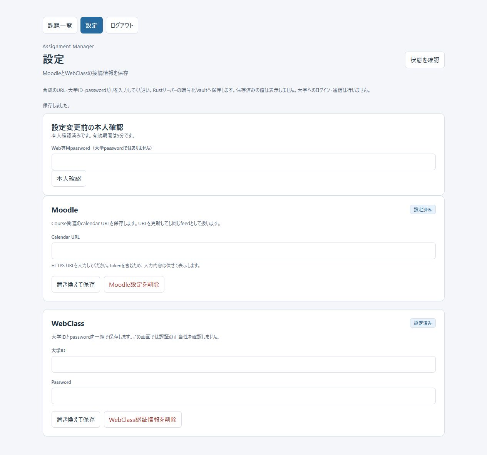
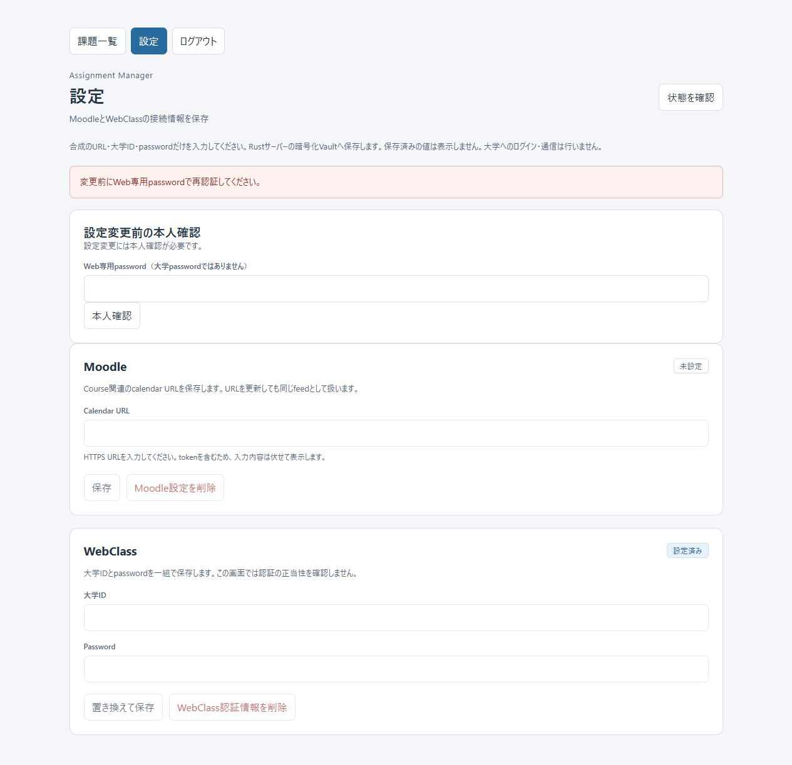

# Phase Web-3B: Encrypted Credential Vault + Settings API

実施日: 2026-10-22（Asia/Tokyo）。Repository: toppoun/assignment-manager。
Branch: feature/web-migration。

**判定: Ready for Web-4。** 実同期前の設計上の着手判定であり、外部公開の承認ではない。
Web-4のfetch/login/sync APIは実装していない。合成credentialだけで検証した。

指定されたWeb migration/authentication/Phase Web-2/3A/frontend資料と、Web server、shared application、
Tauri settings/credential、frontendおよび関連testsを確認した。
root core/schema v3、Tauri Rust/Settings UI、macOS Keychain/UniFFI/SwiftUIは変更していない。

## 1. Changed files

| Files | Change |
| --- | --- |
| crates/web-server/src/control.rs（新規） | control DB/lockをauthから分離、v2 migration、shared connection、整合性検証 |
| crates/web-server/src/keys.rs（新規） | KeyProvider、non-Debug VaultKey、memory test provider、Windows保護鍵provider |
| crates/web-server/src/vault.rs（新規） | encrypted CredentialStore、key binding、nonce履歴、明示初期化、暗号化/永続化tests |
| crates/web-server/src/auth.rs | 既存認証を維持、login共通rate limitのsession-bound reauth |
| crates/web-server/src/routes.rs / state.rs / dto.rs / error.rs | Settings API、owner/reauth検証、safe DTO/error、startup鍵検証 |
| crates/web-server/src/lib.rs / main.rs / assets.rs / poc.rs | 明示init CLI、Web assets、memory test seam、DisabledNetworkBackend維持 |
| crates/web-server/Cargo.toml / Cargo.lock | AES-GCM 0.11.1/zeroizeとWindows keyring provider。ほかのlockfileは不変 |
| crates/web-server/tests/settings_http.rs（新規） | Settings/reauth/authorization/restart/鍵欠落・不一致のintegration tests |
| crates/web-server/tests/auth_http.rs / http_poc.rs / common/mod.rs | 通常testをmemory鍵へ接続、Web-3A/2回帰、204対応 |
| crates/web-server/examples/vault_browser_smoke.rs（新規） | 通常Vaultと独立した固定synthetic環境での明示manual操作 |
| frontend/web_settings.js（新規） / http_api.js | Web設定lifecycle、204/独立GET、不明write、reauth専用error |
| frontend/web.html / web_auth.js / web_app.js | Settings navigation、secret入力、dispose/visibility/pagehide/logout消去 |
| tests/web_settings.test.mjs / dom_fixture.mjs（新規） / web_frontend.test.mjs | Settingsと既存frontend回帰、共通DOM test seam |
| README.md / crates/web-server/README.md / crates/application/README.md | 起動、鍵管理、shared contract、検証方法 |
| docs/WEB-AUTHENTICATION.md / FRONTEND-INTEGRATION.md | reauthとWeb Settingsのsecurity/lifecycle契約 |
| docs/WEB-CREDENTIAL-VAULT.md / PHASE-WEB-3B.md（新規） | 詳細設計と本報告 |
| docs/phase-web-3b-settings.png / phase-web-3b-reauth-expired.png（新規） | secret空欄のBrowser証跡 |

## 2. CredentialStore design

Browser → authenticated route → TenantRuntime owner照合 → ApplicationHandle → SettingsWorker →
既存SettingsService → WebVaultの順。Web専用SettingsServiceは作っていない。
Moodleは1 record、WebClassはID/passwordを同じrecordで保存する。
owner/record-kindがDB keyで、大学IDはpayload内だけに置く。
missingはNone、corruptionはerror。corrupt旧recordはsave/deleteでもsilent overwriteしない。
成功deleteは次statusで未設定。詳細は[Vault設計](WEB-CREDENTIAL-VAULT.md)。

## 3. Encryption format / AAD

RustCrypto AES-256-GCM 0.11.1。採用時に公式API、upstream maintenance/changelog、zeroize機能、
現Rust toolchainとの互換性を確認した。256-bit鍵、CSPRNG 96-bit nonce、128-bit tag。
envelopeはversion 1 byte / key ID 16 bytes / nonce 12 bytes / ciphertext+tag。
AADは固定domain、format version、key ID、length-prefixed internal UserId、kindを束縛する。
logical identityは(owner,kind)。別owner/kindへの差し替え、tag改ざん、unknown version/keyは拒否する。
nonceは永続unique ledgerで再使用を防ぎ、置換/削除/restartでも履歴を消さない。
keyあたり100万nonceでfail closed。plaintextは暗号化前bufferだけにあり、DBへbindしない。
SecretTextのnon-Debug/zeroize contractは維持し、HTTP/OS/Browser全copy消去は保証しない。

## 4. KeyProvider / key lifecycle

暗号処理と鍵custodyを分離。WindowsはWeb専用serviceのCredential Manager Local persistence。
OS entryにはversion/key ID/256-bit鍵だけを保存し、ciphertext backupやcontrol DBへ鍵を入れない。
大学secretをTauri serviceと混在させない。大学IDをOS metadataに使わない。
`init-vault-key`だけが初回CSPRNG生成を許可。既存entryを上書きしない。
encrypted key-checkで空Vaultでもwrong/missing keyを拒否し、鍵紛失時の新規鍵resetを禁止する。
二重processはcontrol lockで拒否。OS書込成功後のDB失敗で残る孤立鍵は、明示initで再利用する。
rotationはkey ID/versionの設計まで。multi-key/re-encryption/rotation/backup/restore CLIは未実装。
Linux/VPSはoperator mount/KMS adapterへ置換できるが、そのproduction provider自体は未実装。

## 5. Control DB migration

control user_version 1→2だけをtransactionで更新。sessionsにnullable reauthenticated_at、
vault_binding/web_credentials/vault_noncesを追加する。accounts/verifier、session行、rate-limit行を保持する。
server restartではmigrationとは別に、既存policyどおりsession行を失効・削除する。
assignment schema v3は不変。future/foreign/partial/corrupt DBは拒否し、migration failureでresetしない。
credential replace/deleteとnonce予約はIMMEDIATE transaction、synchronous=FULL。
acknowledgeはcommit後だけ。rollbackで旧recordを保持する。secret plaintextや途中recordはDBへ保存しない。

## 6. Settings API

| Method/path | Body/result |
| --- | --- |
| GET /api/v1/settings/status | moodleConfigured/webclassConfigured booleanだけ |
| PUT /api/v1/settings/moodle | calendarUrl → commit後204 |
| DELETE /api/v1/settings/moodle | {} → 204、missingも冪等 |
| PUT /api/v1/settings/webclass | universityId/password → 単一record commit後204 |
| DELETE /api/v1/settings/webclass | {} → 204、missingも冪等 |

全Settings APIは認証/owner確認必須、mutationはrecent reauth/CSRFも必須。
Moodleはshared HTTPS/host/userinfo validation、CourseRelated/default.course-relatedを再利用。
WebClass blank ID/empty password、unknown/duplicate fieldを拒否。
URL 2048 bytes、ID 256 bytes、大学password 1024 bytes、Settings body 4096 bytes。
他のmutation bodyは従来の1024 bytes。oversize 413、wrong media type 415、不正入力400。
requestからUserId/credential owner/DB pathを指定できない。保存済みsecretや大学IDを返すGETはない。

## 7. Reauthentication

POST /api/v1/auth/reauthにWeb専用passwordを送る。既存LocalPasswordProviderのArgon2id verify、
login共通のglobal 5試行/60秒、Semaphore 1 permitを使う。大学passwordを照合しない。
成功204で当該sessionの時刻だけを更新し、`0 <= age < 300秒`を許可する。
別session/loginへgrantを引き継がず、logout/rotation/expiry/restartで一緒に消える。
wrong passwordは403 reauth_failed、missing/expiredは403 reauth_required、limitは429。
専用403はBrowser loginを維持し、安全な本人確認案内にする。passwordは送信開始時にclearする。

## 8. Browser Settings UI

未設定/設定済み表示、保存/置換/削除、再認証、pending重複防止を実装。
settings.jsのconfiguredPresentation/clearSecretInputsを再利用し、desktop invoke modelは維持した。
Web stateはbooleansと固定message/outcomeだけ。保存済みsecretのDOM復元やstorage保存はない。
送信開始、画面遷移、tab非表示、pagehide、logoutで入力を消去。token/passwordは伏せ字、autocomplete off。
204と後続status GETを区別し、GET失敗をsave失敗と混同しない。
不明writeはstatusだけを再取得し、booleanから置換成功を証明できるとは扱わない。自動write retryなし。
dispose/generationで古いGET/write/reauth/finallyからのDOM復活・新view入力消去・後続GETを抑止する。

## 9. Session / authorization / CSRF

Web-3AのCookie/session期限/rotation/logout/disabled account/rate-limit契約を維持。
settings/reauthにもexact Host/Origin、Fetch Metadata、application/json、web-3a custom headerと
session-bound constant-time CSRFを適用する。credential access前に全boundaryを検証する。
認証済みでも別internal UserIdはTenantRuntimeとWebVaultの両方で拒否する。
通常のstatusはrecent reauth不要。Settings mutationはsession Cookieだけでは許可しない。
no-store/CSP/nosniff/no-referrer/frame拒否/CORP、static allowlistを維持する。
TauriへWeb再認証を強制しない。既にadmit済みwriteがlogoutと並行して完了し得る契約は維持。

## 10. Security limitations

公開不可。production HTTPS/Secure Cookie、reverse proxy trust、production provider/ACL、
鍵を分離したbackup/restore、大学別SSRF/egress、HTTP response body制限、実認証検証、
大学credential取扱方針は未実装。HTTPS URLを保存できても通信許可済みにはならない。
DBを変更できるlocal OS attacker、同じowner/kindの旧ciphertext rollback、OS account侵害、
全secret copy消去は保護保証外。path由来key entry identityの移設/restore手順も今後必要。
corrupt recordの修復・鍵紛失復旧は自動化しない。

## 11. Automated tests

| Target | Result |
| --- | --- |
| Web unit | 11 PASS、実OS test 1件は通常ignored |
| Web-3A auth HTTP | 11 PASS |
| Web-2 HTTP regression | 15 PASS |
| Settings/reauth HTTP | 7 PASS |
| Web doc | 0件、command PASS |
| Node frontend | 61 PASS（既存51 + Settings10） |
| 明示Windows OS provider smoke | 1 PASS、専用一時entryだけ作成・削除 |

暗号化roundtrip、nonce/ciphertext randomized、DB/journal plaintext不在、owner/kind/version/key/tag差し替え、
missing/wrong key、partial/corrupt record、save/replace/delete/reopen、SQL失敗時旧値保持を検証。
v1 migrationでaccount/session/rate-limit保持、migration rollback、future/partial schema拒否を確認。
HTTPは401/403、owner不一致、CSRF/Origin/Host/Metadata、reauth/session隔離/300秒境界/rate limit、
shared validation/長さ/strict JSON/413/415、204/status、restart/logout、鍵異常startup拒否を検証。
保存だけでnetwork backendを実行しないことをinert backend testとlocal tripwireで確認する。
Nodeはnavigation、全操作、reauth、入力clear、save/status失敗の分離、不明置換、stale suppression、
logout/pagehide、固定errorとsecret非保存、既存Tauri/completion/filter/sort/timezone回帰を検証する。

## 12. Existing regressions

| Manifest | Unit / doc | fmt --check | clippy all-targets/all-features -D warnings |
| --- | --- | --- | --- |
| root core | 312 / 11 PASS | PASS | PASS |
| application | 32 / 2 PASS | PASS | PASS |
| src-tauri | 18 PASS / library targetなし | PASS | PASS |
| macos-bridge (Rust) | 18 / 0 PASS | PASS | PASS |
| web-server | 44 / 0 PASS | PASS | PASS |

Cargoは--locked --offlineで実行。初回だけ新規依存をcrates.ioから取得した。
Windows sandboxでは既存temp DBの作成が拒否されたため、テストは通常Windows権限で実行した。
incremental cacheのhard-link失敗はcopy fallbackの環境警告。未解決のcode/test/clippy失敗はない。
稼働中のsmoke example exeを再リンクしようとした際のLNK1104は、停止してlock解放後に再実行した。
Tauriはbinary-onlyのため`cargo test --doc`がno library targetsを返す。対象外でありdoc PASSとは扱わない。

```powershell
cargo fmt --manifest-path crates/web-server/Cargo.toml --check
cargo test --manifest-path crates/web-server/Cargo.toml --locked --offline
cargo test --manifest-path crates/web-server/Cargo.toml --doc --locked --offline
cargo clippy --manifest-path crates/web-server/Cargo.toml --locked --offline --all-targets --all-features -- -D warnings
node --test tests/*.test.mjs
```

ほかの各manifestでもfmt/test/doc（libraryがあるもの）/clippyを実行した。
macOS Swift/Xcode/native window/Keychain実機はWindowsのため未検証。実施済みとは扱わない。

## 13. Windows build

`cargo build --manifest-path src-tauri/Cargo.toml --locked --offline --features custom-protocol` PASS。
Web serverとmanual exampleもWindows x86_64 MSVCでbuild/run。
TauriやmacOSの既存credential保存場所・service・public APIを変更していない。

## 14. Manual smoke

Windows上のCodex内蔵Chromiumと、専用`target/web-3b-browser-smoke`の合成環境で実施。
専用Web passwordは非表示terminal入力。鍵はWeb専用Windows保護storeにだけ生成し、terminalへ出していない。
通常`target/web-poc`、Tauri/native credentialは操作していない。

| Check | Observed result |
| --- | --- |
| login / Settings navigation | PASS。合成専用accountで一覧→Settings |
| 初期状態 | Moodle/WebClassとも未設定 |
| reauth | Web専用passwordで成功、入力空欄、設定操作が有効 |
| Moodle save | synthetic example.invalid URLを保存、設定済み |
| WebClass save | synthetic ID/passwordを保存、設定済み |
| Browser reload | 両設定済みを保持、secretは空欄 |
| server停止→再起動 | 旧sessionは失効。再login後も両設定済み |
| saved secret再表示 | UIは値を復元せず、APIはbooleanのみ（HTTP testsでもexact shape検証） |
| replace | Moodle URL/WebClass pairを別synthetic値へ置換、入力は空欄 |
| delete | 個別削除後、両方未設定 |
| reauth期限切れ | 実時間337秒以上経過後のWebClass削除を拒否、本人確認案内と操作停止。再認証後に削除成功 |
| logout / reload | login画面、Settings非表示、secret入力空欄。HTTP testsでも旧Cookie mutation 401 |
| console | 正常login/save/replace時warn/error 0。意図的401/403は拒否検証 |
| listen | Get-NetTCPConnectionで127.0.0.1:3000だけ |
| university HTTP | 0件。DisabledNetworkBackend以外を構築せず、startup/sync endpointなし。local tripwireでも接続なし |

鍵紛失・不一致はmemory provider testsと専用一時OS entryだけで実施し、通常local Vaultを破壊していない。
smoke後にsynthetic Moodle/WebClass recordを削除した。合成account/key bindingは隔離環境に保持する。
証跡に保存済みtoken URL、大学ID、passwordは含まれない。




## 15. Remaining risks / next phase boundary

- 実通信前の大学別SSRF/host/path/port allowlist、DNS/接続先、response body上限、outbound policy。
- production HTTPS/Secure Cookie/proxy trust、service identity/ACL、production key provider。
- 鍵backupとDB backupの分離、restore/移設演習、nonce履歴rollback対策、rotation/re-encryption運用。
- 大学認証・credential取扱規約、hosting適合性、実大学credentialによる明示的検証は未実施。
- single account / single process。multi-user registry/worker資源管理やcross-tab通知は未実装。
- UI上のreauth表示は最後の確認状態で、期限の正本はserver。次mutationで期限切れを反映する。
- WebClass revisionは既存shared contractを維持。将来syncとcredential変更を並行させる前に同userのadmission方針を確定する。
- Swift/Xcode/macOS実機は別環境での検証が必要。

**Ready for Web-4**
