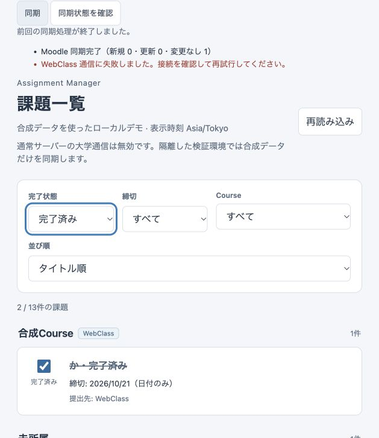

# Phase Web-4A: Asynchronous Web Sync API + Mock Integration

実施日: 2026-10-22（Asia/Tokyo）。Repository: toppoun/assignment-manager。
Branch: feature/web-migration。実行環境: macOS / aarch64-apple-darwin。

**最終判定: Ready（2026-10-22、Windows gate完了。追補§17参照）。**
Windows x86_64 MSVCでTauri build、Rust/Node回帰、全manifestのfmt/clippy、
隔離Mock Browser smoke 19項目、Windows KeyProvider検証がPASSした。
詳細は[Windows検証報告](PHASE-WINDOWS-VERIFICATION.md)を参照。
Web-4B3 Preflightの実大学接続gateは独立して**BLOCKED**を維持する。

以下§1–16は当初のMac検証時点の履歴であり、その中のWindows「未確認」「BLOCKED」や
Web-4B「未実装」は当時の記録。最新のWindows結果と判定は§17を適用する。

## 1. Changed files

| Files | Change |
| --- | --- |
| crates/web-server/src/web_sync.rs（新規） | owner-bound WebSyncCoordinator、memory job/key/result DTO、排他admission、task guards、drain、unit tests |
| crates/web-server/src/synthetic.rs（新規） | feature限定MockSyncBackend、安定identity/core import、partial commit、session/retry模擬、tripwire test |
| crates/web-server/src/state.rs | 既存単一handleとcoordinatorの束縛、Settings mutationのserver task化、job drain |
| crates/web-server/src/routes.rs / error.rs | Sync POST/GET、既存認証・CSRF boundary、409 sync_running |
| crates/web-server/src/lib.rs / main.rs | feature限定example bind seam、通常DisabledNetworkBackend維持、表示名更新 |
| crates/web-server/src/assets.rs / Cargo.toml | 共通sync.js/Web controller配信、synthetic-sync featureと専用example |
| crates/web-server/examples/sync_browser_smoke.rs（新規） | 通常DB/Vaultから独立したWindows永続smokeとportable ephemeral smoke |
| crates/web-server/tests/sync_http.rs（新規） | auth、source matrix、dedup、concurrent tabs、socket切断、completion、revision、panic、shutdown/restart |
| crates/web-server/tests/http_poc.rs | 追加済みendpoint/共通moduleに合わせた旧不在assertionの更新 |
| frontend/web_sync.js（新規） | bounded polling、認証lifetime、結果表示、曖昧POSTの同key再確認 |
| frontend/http_api.js / web_auth.js / web.html | strict Sync adapter、認証lifetimeのpanel、Settings遷移で監視維持 |
| frontend/web_settings.js | sync_runningの安全な日本語表示 |
| frontend/list_view.js | dispose後のnative select options復元（Browser smokeで発見） |
| tests/web_sync.test.mjs（新規） | polling/DTO/timeout/dispose/同期とcompletion/認証lifecycle |
| tests/dom_fixture.mjs / web_frontend.test.mjs / web_settings.test.mjs | panel fixture、既存回帰のrequest scope整理、native selectと409回帰 |
| README.md / crates/web-server/README.md / crates/application/README.md | 起動・API・排他・shutdown・synthetic環境・制限 |
| docs/FRONTEND-INTEGRATION.md / WEB-AUTHENTICATION.md / WEB-CREDENTIAL-VAULT.md | 現行Web-4Aのlifecycle/認可/credential admission |
| docs/PHASE-WEB-4A.md / phase-web-4a-partial.png（新規） | 本報告、Mac合成Browser証跡 |

core、shared applicationのRust API、Tauri、macOS bridge/Swift/Keychain、DB schema、lockfileは不変。

## 2. Sync API architecture

```text
Authenticated Browser (JSON + Cookie + CSRF + Idempotency-Key)
  → existing HTTP boundary / internal UserId / TenantRuntime owner
  → owner-bound WebSyncCoordinator
  → server-owned supervisor task → ApplicationHandle::sync_now()
  → existing SyncWorker / SyncService
  → DisabledNetworkBackend (ordinary binary)
    or explicitly injected MockSyncBackend (isolated test/example only)
  → validated core batch / SQLite v3 import and update
```

HTTP handlerは受付だけを行い、同期終了をawaitしない。requestごとにhandleやworkerを作らない。
GETは観測だけで同期を開始しない。同期のsource orchestration、credential load、session revision、
single-flight、partial failure、completion所有権は既存Rustに置く。

| Endpoint | Response |
| --- | --- |
| POST /api/v1/sync、body `{}` | 202 `{runId,state:"running",statusUrl:"/api/v1/sync/runs/<id>"}` |
| GET /api/v1/sync/status | 200 `{running,activeRunId,lastRun}` |
| GET /api/v1/sync/runs/{runId}、running | 200 `{runId,state:"running"}` |
| 同finished | 200 `{runId,state:"finished",report:{moodle,webclass},shouldReload}` |
| worker/report異常 | 200 `{runId,state:"failed",error:"job_failed",shouldReload:true}` |
| defensive shared AlreadyRunning | state=failed、error=already_running、shouldReload=false |

完了済みkeyの再送も202で元runを返す。この場合受付DTOのstateはfinished/failedで、再実行しない。
未知/期限切れ/再起動前runは404。run IDは256-bit OS乱数、64文字lowercase hex。

全Sync APIはCookie検証、enabled account、生きたsession、internal UserId、TenantRuntime ownerを検証。
POSTは既存Host/Origin/Fetch Metadata/application/json/web-3a custom headerとsession-bound CSRFを要求。
recent reauthは通常同期に不要。設定変更のrecent reauth要件は維持する。
別ownerはtenant boundaryで403、当該owner内の未知IDは404。requestでowner/DBを指定できない。

## 3. WebSyncCoordinator

PocState内のimmutable ownerと同じUserIdに束縛し、同じApplicationHandleをcloneして所有する。
短いstd::sync::Mutexで扱うのはclosing / mutation reservation / active run / bounded history / key hashだけ。
DB、credential、networkのawait中にはそのmutexを保持しない。
key/body/secretや内部causeをログへ出さず、DTOはSyncReportから固定fieldだけを明示投影する。

## 4. Job lifecycle

admission lock内でrunをrunningへ予約→guardをserver taskへ移す→202を返す。
監督taskが子taskのjoin結果を観測し、完了/エラー/panicをterminal stateへ変更する。
Application SyncWorkerがpanicしてreplyを失ってもjob_failedとなり、runningが残らない。
JobGuardのDropも未完了runを安全なfailedへ移す。worker panic後にworkerを自動再生成はしない。
HTTP response drop、実socket切断、Browser logoutは採用済みjobをcancelしない。
source内の割合やphase進捗は提供せず、今回の進行状態はrunning/terminalのみ。

## 5. Single-flight

同ownerのactive jobは1件。別key/複数tabの追加POSTはactive runを202で返す。queueは作らない。
既存SyncWorkerのsingle-flightも残し、防御的AlreadyRunningはsharedのreload=falseを維持。
新規runはownerにつきrolling 60秒で5件まで、429 + Retry-After:60。
同key replayは新規runのrate budgetを消費しない。
単一process・単一accountの保証。既存control DB lockは同一directoryの二重processを拒否するが、
別DB/別process/分散serverをまたぐsingle-flightやdistributed job ownershipは実装していない。

## 6. Idempotency

Idempotency-Keyはrun IDと別の値。ASCII英数字と `._-` の1–128文字、欠落/重複header/不正値は400。
owner-bound coordinator内にSHA-256だけを保持し、同keyを同runへ対応させる。
全要求bodyはstrictな空objectなので異なるpayloadのrequest-hash比較は不要。
別keyでもactive runに対応させ、再送後に別jobを作らない。

最大128key・128result。keyは受付から1時間（実行中は期限を越えて保持）、resultは完了から1時間。
live dedup recordを新規受付のために追い出さず、満杯なら429で拒否する。
上限と期限をunit testで時計待ちなしに検証。旧提案の24時間ではなく、このPoCでは1時間を採用。
memoryだけなのでrestart後はkey/history/rate budgetが失われる。再実行防止をrestartや期限後まで保証しない。
過去runを成功として復元しない。ログインsessionも既存policyでrestart失効する。

## 7. MockSyncBackend

`synthetic-sync` featureでのみ提供。通常binaryはfeatureを有効にしてbuildしても常にDisabledNetworkBackend。
実大学backendを選べるCLI/envは追加しない。隔離test/exampleだけが明示注入する。
公開されたexample.invalidのURL・synthetic ID/password定数以外はmockが拒否する。
HTTP client、Moodle fetch、WebClass login、認証Cookie、SAML処理は作らない。

mockはvalidated AssignmentCandidateBatch→既存SqliteStore::import_assignment_batchを使う。
origin/scope/external IDは固定、title revisionはtest controlで変更可能。
Moodle/WebClassの成功・失敗・未設定、両成功、片方失敗、両失敗を実装。
partial failureは実際にcore importをcommitした後で固定failureを返す。
再同期は同identityを更新し、duplicateを作らず、coreのfield ownershipでcompletionを保持する。

WebClass sessionはSyncServiceが再利用。save成功後revisionが変われば古いsessionを破棄。
削除→未設定→再保存も検証。AuthExpired相当は最初のimport commit→fresh credential callbackを1回→
模擬session置換→全importを1回retry。2度目expiryはauthentication_failed。
最終attemptのcountsだけを返し、最初のcommitは残す。これはtransport contractの模擬であり、
本物のSSO/cookie/HTTP protocol compatibilityを検証したものではない。

## 8. Source results

| status | Safe fields |
| --- | --- |
| not_configured | statusだけ |
| success | counts.created / updated / unchanged |
| failed | allowlist SyncFailure::code()だけ |

固定failure codeはnetwork_failed、authentication_failed、invalid_configuration、source_data_invalid、
persistence_failed、credential_unavailable、unexpected。
raw URL/token/password/大学ID/Cookie/HTML/SAMLResponse/内部causeは結果に含めない。
Completedはrun終了の意味で、両sourceの成功を意味しない。
shouldReloadは既存SyncReportを利用し、設定済みsourceを試した部分失敗・全失敗でもtrue。
worker異常はcommit有無が不明なのでtrue。両source未設定・AlreadyRunningはfalse。

## 9. Credential change concurrency

同期受付と全credential save/delete受付を同じowner-scoped admission lockで排他にする。
sync中のMoodle/WebClass置換・削除は409 sync_running、mutation中の新規syncは503 busy。
単なるstatus確認→saveではなく、checkとreservationを同じcritical sectionで行う。
Settings操作もserver taskへguardを移し、実際のSettingsWorker replyまで保持する。
HTTP futureを破棄してもsave完了前にguardを解放しない。shutdownもこのmutationをdrainする。
既存SettingsServiceのpersist成功後revision更新・次sync時session invalidationを維持。
通常の課題query/completionは別workerで利用でき、SQLite IMMEDIATE transactionのcommit順に整合する。

## 10. Frontend sync UI

web_sync.jsはsync.jsのsourceResultPresentation / syncButtonStateを再利用。
Tauri sync_view/settings_view/invoke pathは変更せず、HTTP allowlistにも加えない。
認証lifetimeごとにcontrollerを作り、Settings遷移で継続。前回結果・source counts・固定日本語messageを表示。
serverの409は「同期中は認証情報を変更できません。同期終了後に再試行してください。」と表示。

running中だけ1.5秒間隔、最大120回。各HTTP requestは10秒timeout。
polling error/期限切れは観測失敗であり、source同期失敗と断定しない。
既知runは同run IDで再確認。POST応答喪失時はkeyを保持し、明示同期操作だけが同keyで再送する。
画面遷移・状態確認のGET経路ではPOSTを再送しない。restart/期限後はdedupを保証できないと案内する。

logout/session replacement/disposeでtimerを中断し、古いGET/POST/body/result/finallyの描画・follow-upを抑止。
終了時はshouldReloadに従い、現在のfilter/sortで共通list queueへ再query。
completion pending/reconciliationを追い越さず、同期後もuser completionを保持する。
Browser smokeで発見した、disposeによりnative Course selectのoptionが消えて次loadが失敗する問題も修正。
option復元前のnative select値拒否を模擬したNode回帰を追加した。Asia/Tokyo表示は変更しない。

## 11. Shutdown / restart

HTTP/job admission停止→HTTP drain→受付済みjobとSettings mutation drain→ApplicationHandle shutdown→auth/control close。
SyncWorkerにcancel APIはないため、このserver自体はgraceful drainのdeadlineを設けない。
外部supervisorの時間制限・強制終了・crashでは処理が途中で止まり得る。
restart後はlastRun=null、旧run404、旧session401。dedupも消失。
SQLiteのcommit済みpartial data/completion/暗号化credentialは保持し、履歴がないことを成功へ偽装しない。
portable ephemeral exampleだけは一時DBを破棄するので、永続restartはHTTP testsとWindows固定smoke環境で扱う。

## 12. Security boundaries

大学HTTPは0件。これは通常Disabled / mockの構造とlocal tripwire、合成HTTP testsによる証拠であり、
OS全体のpacket captureを行ったという意味ではない。実credentialや通常Web/native Vaultを使っていない。
root core既存HTTP mockテストはローカルfixture serverだけを使用する。

実大学接続の前に必要なorigin/host/path/port allowlist、SSRF/DNS rebinding、outbound制限、
redirect origin検証、response body上限、HTTP timeout、WebClass session isolation、secret logging review、
hosting SSO検証をWeb向けに実装済みとは主張しない。
production HTTPS/Secure Cookie、公開用key管理/ACL/backup/restoreも未実装。
loopback以外のbind、LAN/public部署、PWA、signup、PostgreSQL、学期/submission/timetableは追加していない。

## 13. Automated tests

最終実行はlocked/offline。Web all-features: unit 15 + auth HTTP 11 + Web-2 HTTP 15 + Settings HTTP 7 + Sync HTTP 8 = **56 PASS**。
通常feature構成: **49 PASS**。Node全frontend: **76 PASS**。

Rustは未認証/CSRF/Origin/Host/Metadata/JSON/disabled/logout/owner拒否、run IDとrunning/finished、
source matrix、partial commit、duplicateなし、completion保持、同key replay、別key・複数session同時要求、
Response破棄と実TCP client切断、Settings置換/削除409、mutation中sync拒否、request future破棄後のmutation排他、
revision/session再利用・破棄、AuthExpired1回retry、worker panic、AlreadyRunning reload=false、
shutdown drain、restart旧run404、key容量/期限、safe DTOとtripwireを検証する。
raceはNotify/channel/oneshotで制御し、sleep待ちで成立させていない。

Nodeは202/Idempotency-Key/CSRF、button、bounded polling、全source結果、他tab active run、
polling失敗/timeout、曖昧POST、navigationでwrite再送なし、logout/dispose stale抑止、
current filter/sortとcompletion pending、Settings409、native select復元、Tauri sync/settings、Web auth/session、timezone回帰を検証。

## 14. Existing regressions

| Manifest | Tests / doctests | fmt --check | clippy all-targets/all-features -D warnings |
| --- | --- | --- | --- |
| root core | 312 / 11 PASS | PASS | PASS |
| application | 32 / 2 PASS | PASS | PASS |
| src-tauri | 18 PASS / library targetなし | PASS | PASS |
| macos-bridge Rust | 18 / 0 PASS | PASS | PASS |
| web-server all-features | 56 / 0 PASS | PASS | PASS |

Tauriはbinary-onlyなのでcargo test --docのno library targetsは対象外。doc PASSとして数えない。
Macではtempdirの/var symlinkを既存PoCが拒否するためTMPDIR=/private/tmpを使用。
loopback bindを含むRust testsはsandbox外の承認済み実行。最初のsandbox/path失敗をPASSとして数えていない。
依存が未cacheだったため最初だけcrates.io取得、その後locked/offlineで検証。
一度の自動承認レビュー失敗は利用上限によるもので、復旧後に同じテストを再実行して通過した。
Swift/Xcode/native window/Keychain実機テストは今回は実施していない。Windows上でも未実施であり、
Rust bridge回帰をmacOS実機試験の代わりには扱わない。

Windows Tauri buildは `--target x86_64-pc-windows-msvc --features custom-protocol` で試行。
Windows向け依存を取得後、`E0463: can't find crate for core`（target未導入）で停止した。
このMacにはWindows MSVC target/toolchainがなく、Windows build PASSとは報告しない。

再現用Web checks（MacはTMPDIR=/private/tmpを設定してtestを実行）:

```powershell
cargo fmt --manifest-path crates/web-server/Cargo.toml --check
cargo test --manifest-path crates/web-server/Cargo.toml --locked --offline --all-features
cargo test --manifest-path crates/web-server/Cargo.toml --locked --offline
cargo test --manifest-path crates/web-server/Cargo.toml --doc --locked --offline
cargo clippy --manifest-path crates/web-server/Cargo.toml --locked --offline --all-targets --all-features -- -D warnings
node --test tests/*.test.mjs
```

Windows hostでは別途 `cargo build --manifest-path src-tauri/Cargo.toml --locked --offline --features custom-protocol` を実行する。

## 15. Windows manual smoke / supplementary Mac Browser smoke

**Windows Browser manual smokeは未実施。** 専用exampleの固定target/web-4a-browser-smokeで次を実施する。
通常target/web-pocやdesktop/native Vaultを削除・初期化しない。起動/合成credential/scenarioはweb-server README参照。
`serve paced` はmanual専用で各sourceを10秒待機させ、running表示・同時tab受付・Settings409を再現できる。
自動race testsはこの待機を使わず、channel/Notifyで同期する。

| # | Windowsで残る確認 |
| --- | --- |
| 1–3 | login、Settingsでsynthetic設定、一覧 |
| 4–6 | Sync、実行中表示、source別結果 |
| 7–9 | 課題追加/更新、再Sync duplicateなし、completion toggle→Sync保持 |
| 10–11 | webclass-partial後reload、both-failure表示 |
| 12–13 | 同時Sync、複数tab |
| 14 | 同期中Settings置換/削除409 |
| 15–16 | logout中job、永続環境server restart |
| 17–19 | Chrome console、127.0.0.1だけlisten、大学HTTP0 |

MacのCodex内蔵Chromiumでは、新しい一時DB + memory鍵 + webclass-partialで補助確認した。
login→reauth→synthetic両設定→一覧→SyncでMoodle成功/WebClass失敗を表示し、11→13件へのreloadを確認。
合成Moodle課題を完了→all/title条件→再Syncで13件のまま、Moodle unchanged=1、完了保持を確認。
completed/title条件で2/13件、別tabも同じ前回結果、logoutでpanelと一覧消去を確認。
修正前にCourse select errorを1件発見したが、修正後の新しいtabのconsole warn/errorは0件。
listenはlsofで127.0.0.1:3000だけ。使い捨てserverは正常終了し、一時DBを破棄、port閉鎖を確認した。
速いmockのrunning表示、同時tab受付、Settings409、logout中job、永続restartはdeterministic Rust/Node testsで補う。
これはWindows smokeの代替完了記録ではない。



## 16. Remaining limitations / next gate

- 必須のWindows Tauri build、Windows Browserの19項目smokeが残る。これが今回のBLOCKED理由。
- memory job/history/key/rate budgetはrestartで消失。durable queue、分散single-flight、exactly-once保証なし。
- worker panic後は安全なfailedを返すが、workerの自動回復は行わずserver再起動が必要。
- graceful drainのdeadline/cancelなし。強制終了では途中commitまで保持。
- Browserの他tabは次requestまで古い表示が残り得る。cross-tab自動通知なし。
- MockはSSO/protocol/real networkを立証しない。大学接続・production安全性は別Phaseの明示許可が必要。
- Web-4Bは実装していない。

**当初判定（Mac検証時点）: BLOCKED。Windows gateは下記§17で解消。**

## 17. Windows final verification（2026-10-22追補）

検証HEAD: `ea384dfac97eec1c37523a7f59e94829fcd8eaea`。
Branch: `feature/web-migration`。開始時working treeはclean、commit/pushなし。
環境: Windows x64 / 25H2 / build 26200.9711、Rust/Cargo 1.97.1、
`stable-x86_64-pc-windows-msvc`、MSVC toolset 14.44.35207、Node v24.12.0。

| 必須項目 | Windows結果 |
| --- | --- |
| Tauri `cargo build --manifest-path src-tauri/Cargo.toml --locked --features custom-protocol` | PASS |
| Web all-features / default | 61 / 49 tests PASS。Windows専用ignored testは別実行で1 PASS |
| core / application / macos-bridge Rust / Tauri Rust | 346+11 doctests / 34+3 doctests / 18 / 18 PASS |
| frontend `node --test` | 76 PASS |
| 5 manifestsのfmt / clippy all-targets/all-features `-D warnings` | 全PASS |
| Windows Browser smoke | 下記19項目すべてPASS |
| Windows KeyProvider | 一時entryの作成・再open・非上書き・削除・missing key fail closedをPASS |
| Web-4B1〜4B3回帰 | NetworkPolicy / GuardedResolver / secured backend / run budgets / 隔離HTTPS E2E PASS |

BrowserはWindows上のCodex内蔵Chromiumを使用。
README指定の`sync_browser_smoke`を`serve paced` / `serve webclass-partial` / `serve both-failure`で実行した。
使用先は`crates/web-server/target/web-4a-browser-smoke`とその専用Windows鍵だけ。
通常`web-poc`、既存Web Vault、Tauri/native DB・鍵は変更していない。

| # | Browser確認 | 結果 |
| --- | --- | --- |
| 1 | Login | PASS。専用synthetic accountでlogin |
| 2 | Synthetic Moodle/WebClass Settings | PASS。本人確認後に公開mock定数だけを保存 |
| 3 | Assignment list | PASS。初期11件、Asia/Tokyo表示 |
| 4 | Sync開始 | PASS。Browser操作から非同期jobを受付 |
| 5 | Running表示 | PASS。paced同期中表示・ボタン無効化 |
| 6 | Moodle/WebClass別結果 | PASS。初回各created=1、一覧13件へ自動更新 |
| 7 | 課題追加・更新 | PASS。追加後、専用DBの合成タイトル1件をstale fixtureにして再同期、Moodle updated=1 |
| 8 | 再同期duplicateなし | PASS。両created=0 / unchanged=1、全13件 |
| 9 | Completion保持 | PASS。Browserで完了にしたMoodle課題を再同期・更新・restart後も保持 |
| 10 | WebClass部分失敗後reload | PASS。stale WebClassタイトルをcommitしてから失敗、手動reloadなしでv0表示へ更新 |
| 11 | Both failure表示 | PASS。両sourceの安全な通信失敗message |
| 12 | 同時Sync操作 | PASS。追加HTTP要求も202で同じactive run、queueなし |
| 13 | 複数Browser tabからSync | PASS。2 tab同時操作で両方running→同じ初回結果 |
| 14 | 同期中Settings変更409 | PASS。Browser拒否messageと両sourceのPUT/DELETE全4件409 sync_running |
| 15 | Logout中job継続 | PASS。logout→再loginでもrunning継続、その後正常完了 |
| 16 | Server restart後 | PASS。旧session401、旧run404、lastRun=null、Vault両設定・13件・completion保持 |
| 17 | Browser console | PASS。検証した両tabのwarn/errorは0件 |
| 18 | 127.0.0.1だけlisten | PASS。netstatで127.0.0.1:3000だけ、終了後listen消失 |
| 19 | 大学HTTP通信0件 | PASS。MockはHTTP clientを作らず、tripwire / secured deny testsもPASS。OS全体のpacket captureではない |

初回sandbox内では一時DB作成の`Internal`と一部core HTTP fixture失敗があった。
通常Windows権限で再実行して全suiteがPASS。失敗を合格数に含めず、
reparse point拒否・認証・Vault・DNS/TLS制限などを緩和していない。
Windows固有の実装不具合は見つからず、production code・lockfileの修正は不要だった。


全実行command、19項目の詳細、process restartと鍵の証拠・限界は
[PHASE-WINDOWS-VERIFICATION.md](PHASE-WINDOWS-VERIFICATION.md)を参照。

**Ready — Web-4AのWindows必須gateは解消。Web-4B3 Preflightの実大学接続gateはBLOCKEDのまま。**
