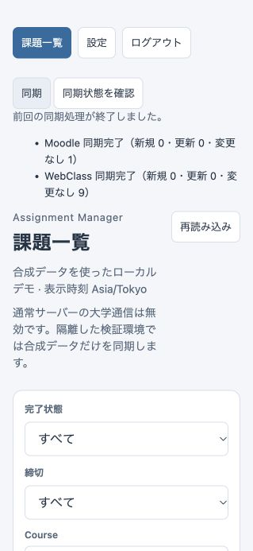

# Phase Web-4B3 Preflight: Real University Sync Readiness

2026-10-22（Asia/Tokyo）。toppoun/assignment-manager、feature/web-migration。
検証環境: macOS / aarch64-apple-darwin。

**判定: BLOCKED。** Mac/offlineのsecured Web HTTP E2Eは完了したが、実接続の前提が未確定。
Moodleの利用対象exact host/path・CourseRelated契約、現行IdP/LMSの確認、大学利用条件、
MacのWeb専用永続鍵管理、実接続専用entrypointのreviewが残る。
**実大学HTTP/DNS、実credential、通常native/desktop資格情報ストアは使用していない。commit/pushなし。**
**Web-4AのWindows build / Browser smokeは未完了・BLOCKEDのまま。**
実接続は別途の明示承認が必要であり、本書やsynthetic featureの追加は承認を代替しない。

## 1. Current implementation review

指定されたWeb-4A/4B1/4B2、network/vault/auth設計、Web READMEと、secured_sync、
university_network、webclass_auth、moodle_http、application sync_service/runtime、
Web state/web_sync/vault/keysを確認した。

- 通常起動は `PocState::open` → local KeyProvider → `open_with_key_provider` → DisabledNetworkBackend。
  all-featuresでも通常binaryの選択は同じ。startup sync OFF、実接続へ切り替えるflag/envなし。
- Web-4B2のSecuredCoreSyncBackendはimmutable NetworkPolicyを所有するSecuredSyncClientsを使う。
  Moodle、初回SSO、reauth once、cached sessionは同じfactory/run budgetを使う。
- WebSyncCoordinatorは認証ownerに束縛した1つのApplicationHandleを保持。
  SyncWorker / SyncService / core parser/import / SQLite v3を再利用する。
  HTTP handlerが新しい同期runner、DB import、session管理を実装する経路は追加していない。
- Vaultの暗号format、nonce ledger、binding、credential revision、CSRF/recent reauth、
  partial commit、completion所有権、shutdownの順序を維持した。

今回の変更:

| File | 内容 |
| --- | --- |
| src/synthetic_university.rs / webclass_auth_fixture.rs | 固定HTTPS大学fixture、既存SSO scriptの共通化 |
| src/university_network.rs / webclass_auth.rs / webclass_http.rs | 固定fixtureだけのprivate policy/resolver/CA/origin引継ぎ |
| src/webclass_auth_tests.rs / university_network_tests.rs | 共通fixtureへの追従、既存assertion維持 |
| crates/web-server/src/secured_synthetic.rs / lib.rs | 専用runtimeへのSecuredCoreSyncBackend注入、通常選択維持 |
| crates/web-server/examples/secured_browser_smoke.rs | 一時DB/memory鍵の専用Browser entrypoint |
| crates/web-server/tests/secured_https.rs | 実TCP HTTPからsecured TLSまでの5 tests |
| Cargo.toml / crates/web-server/Cargo.toml・Cargo.lock | offline fixture featureとtest用依存edge。依存version更新なし |
| 新規2文書 / Browser画像 / README・関連設計資料 | 本報告、手順、鍵/通信境界の追補 |

## 2. University hostname / path confirmation status

大学へのHTTP/DNSを実行せず、repository内の非secret定数/資料と、検索サービスが返す大学公式資料の
索引表示内容だけを比較した。大学URLのopen、PDF取得、curl、DNS lookup、loginは行っていない。
索引は原文の再取得・現在の稼働確認ではなく、完全な認証遷移や利用条件の確定にも使わない。
実設定/Keychain/既存credential/token queryは読んでいない。

| 対象 | コードの要求 | 資料による確認 / 残項目 |
| --- | --- | --- |
| Moodle exact host | default未設定 | **未確認**。利用者の対象Moodleと紐づく2026年度資料が必要 |
| Moodle calendar path | operator確認済みexact path。fixtureは /calendar/export_execute.php | **未確認**。一般的なMoodle pathやfixtureを大学の承認値にしない |
| Moodle scheme/port | HTTPS / 443、redirectなし | 実大学TLS/到達性は未確認 |
| Moodle export/scope | CourseRelated / default.course-related | コード契約は確認済み。対象大学の「コース関連」export選択はoperator確認待ち。queryから推測しない |
| HOPPII | https://hoppii2025.hosei.ac.jp | **2026年度公式案内に記載あり**。現在のTLS/DNS/認証稼働は未確認 |
| IdP / OpenAM | https://idp.hosei.ac.jp | コード値のみ確認。現行originと認証手順を確定できず**未確認** |
| WebClass LMS | https://lms2025.hosei.ac.jp | コード値/過去manual参照のみ。2026年度のSSO先として**未確認** |
| login/SAML/CSSO | 下記既存step別origin検証 | 合成fixtureでは確認済み。実SSO/MFA/WAF/Cookie共有要件は**未確認** |

2026年度の公式案内の索引:

- [社会学部 2026年度履修登録について（2026-03-13）](https://www.hosei.ac.jp/shakai/info/article-20260226164722/)
  はHoppii・学習支援システムのリンク先に既存2025 hostnameを記載している。
- [2026年度 人間環境学部授業関連情報](https://www.hosei.ac.jp/ningenkankyo/zaigakusei/class_information/2026/)
  も仮登録先に同じhostnameを記載している。年度から2026 hostnameを生成する根拠はない。
- [情報科学部 在学生の方へ](https://cis.hosei.ac.jp/info/students/)の索引にはCIS Moodleの案内があるが、
  これだけでは対象利用者のexport host/pathは決まらない。
- [2020年CIS guide](https://cis.hosei.ac.jp/wp-content/uploads/2020/03/cisguide2020.pdf)の索引に
  cms.cis.k.hosei.ac.jpの記載がある。**古い候補資料にすぎず、allowlistには採用しない。**

公開資料の通常Browser利用案内を第三者backendでの認証・取得の許諾と解釈しない。
実利用条件/本人accountの利用範囲/自動取得可否はoperatorによる確認が必要。
今回production allowlistや年度定数は変更していない。

既存WebClass遷移の必要範囲:

1. HOPPII /portal/u001/index.php → IdP SSO/XUI。
2. IdP /openam/json/authenticate ×3 → success / consent → SAML。
3. SAML form POST先はHOPPII exact origin。portal login/user-page GETもHOPPII内。
4. HOPPII /portal/sso/Parm.php → CSSO form POST先はLMS exact origin。
5. LMS内だけのHTTP/限定JS redirect → courses array検証 → courses/contents API。

SAML/CSSOだけが意図したcross-origin form転送。未知origin、認証protocol変更、Cookie共有要求は停止。
全outbound method/path/bodyの詳細は[network inventory](WEB-NETWORK-SECURITY.md#outbound-inventory)。

## 3. Secured runtime injection

通常binaryはDisabled、既存synthetic-sync exampleはMockのまま。
新しい `secured-synthetic` featureの専用example/testだけが次の経路を選ぶ。

```text
Browser / actual loopback HTTP
 → Authentication + CSRF + owner / encrypted WebVault
 → WebSyncCoordinator → ApplicationHandle → SyncWorker → SyncService
 → SecuredCoreSyncBackend::new(fixed synthetic policy)
 → standard TLS + fixed fake DNS → four synthetic HTTPS listeners
 → existing core parser/import → SQLite → HTTP DTO → Browser list
```

`secured_synthetic::open`はmemory providerと固定scenarioだけを受け取る。
policy/backend/CA/DNSをHTTP、browser、env、CLIから受け取らない。
coreの `synthetic-https-fixture` は明示的なoffline検証用build feature。
公開するのは固定fixtureの生成とそのpolicyで、任意CA/DNS注入APIではない。
all-featuresではこの固定fixtureもcompileされるが、通常binaryからは選択できない。

固定fixtureは自身がbindした4個のIPv4 loopback listenerのpeerだけを返すresolver、
4個のsynthetic.invalid hostname、fixture CA、HTTPS/443を使う。
WebClass roleは3 origins、Moodleは既知の合成URLのみ。未知hostでOS DNSへfallbackしない。
fixture policyへwith_moodle_calendarを呼んでも大学/任意originへ拡張できない。
WebClassも公開された合成ID/password以外はHTTP送信前に拒否する。
CAのOS install、hosts file変更、system DNS/Keychainの変更はない。
汎用のTestNetwork / 任意CA・resolver入力は引き続きcfg(test)内部だけ。

将来の実接続runtimeは、確認済みpolicyをRust内で固定し、既存
`PocState::open_with_backend` にSecuredCoreSyncBackendを明示注入する専用module/entrypointとする。
policy変更はadmission停止→drain→runtime/session再生成。通常binaryのtoggleにはしない。
**実接続entrypointは今回作成していない**。未確定policy/key custodyのまま起動可能にしない。
現在のseamはsynthetic所有のPocDatabaseを受け取るため、real用には専用directory/marker/lockと
seedなしのDB初期化をreviewし、privateなstorage入力境界を一般化する必要もある。
SYNTHETIC-ONLY marker付きDBをreal credential/data用に転用しない。

## 4. Credential / key provider status

MacでもWebVaultの暗号化/復号とworker統合はmemory providerの明示注入で動く。
通常起動のlocal_provider / init-vault-keyはnon-Windowsでvault_unavailableを返す。
今回のMac回帰testで通常起動がmemory/native Keychainへfallbackしないことを確認した。

| 境界 | 現状 |
| --- | --- |
| Windows Web鍵 | org.assignmentmanager.web.vault.keys.v1 / canonical control path hash。既存実装維持、今回OS上で未検証 |
| Mac native / Tauri鍵 | 既存service/accountsに変更なし。今回providerを開いていない |
| Mac synthetic | CSPRNG MemoryKeyProviderを明示生成、WebVault bindingを明示初期化、毎回専用一時DB |
| 鍵寿命 | Arc providerが生存中だけload可能。raw鍵はzeroizing。最後のprovider破棄でメモリ解放 |
| DBとの独立管理 | control DBはciphertext/key ID/nonce/bindingだけ。鍵file/env/plaintext fallbackなし |
| runtime再生成 | 同じmemory providerを保持する同一process内の再openならcredential、課題、completionを保持 |
| process再起動 | 新しいmemory鍵では旧Vaultを開けない。missing/wrong keyは停止、binding/credentialをresetしない |
| Browser example終了 | runtime drain後fixture停止→一時DB破棄→memory鍵破棄。再起動は新しい合成環境 |

HTTP E2Eのrestartは**同一process内で同じproviderを保持したruntime再生成**。
processを跨ぐ鍵保持やMac永続運用を検証したとは主張しない。

Mac Web専用providerの将来案は別service `org.assignmentmanager.web.vault.keys.v1` + installation hash、
明示init/load-only、missing/corrupt/wrong key fail closed、OS entryへkey format/ID/keyだけ、
credentialは独立control DB、鍵/DBの別backup管理を基本とする。
ただしアクセス制御、Keychainのunlock/interaction、path移設、rotation、backup/restore、
process restartの保持をreviewするまでは**設計案のみ**。実secretの永続保存経路は追加していない。

## 5. Full synthetic Web HTTP E2E

新規[secured_https.rs](../crates/web-server/tests/secured_https.rs)は本物のTCP HTTP APIを使い、
認証→reauth→Vault保存→Sync POST/poll→actual TLS SSO/fetch→parser/import→GET一覧まで一続きで通す。
core protocol fixtureのExchange / FullFlowを共通fileへ移し、既存testsと共有した。
認証protocolやimportをWeb用に複製していない。

5 tests:

- source matrix（8組）: 未設定、各source単独、両成功、各source失敗、両失敗、Moodle body超過。
- cached HTTPS session再利用、save成功後revisionによるfresh SSO、再import created=0、completion保持、
  runtime再open、旧session401/旧run404、同じmemory鍵で保存credential保持、wrong key起動拒否。
- AuthExpired一度は再認証成功、二度目は停止。初回と再認証は同じsecured factory。
- fixture policy拡張拒否、未承認host/path/IP/別合成credential拒否、fixture request=0。
- Mac通常起動/initのVaultUnavailableとfallback不在。

初回成功はMoodle1 / WebClass9。既存seed11件から全21件へ更新。
再同期はMoodle unchanged1 / WebClass unchanged9、created0、全21件、completion保持。
IdPのparent Domain Cookieを含め、SSO scriptと受信側assertionでorigin別分離を検証する。

## 6. Required scenario evidence / security boundaries

既存Web-4B2/Web-4A testsを再実装せず、成功経路の跨crate接続と鍵境界だけを追加した。

| 要件 | 今回再実行した証拠 |
| --- | --- |
| Moodle / WebClass / 両成功、片方/両方失敗、未設定 | 新規real_http_auth_vault_secured_tls_parser_sqlite_source_matrix |
| 同期後一覧、completion、duplicateなし | 新規https_cached_session_revision_reimport_completion_and_restart_with_memory_key、Node list/sync回帰 |
| cached session / credential変更後破棄 | 新規HTTPS reuse/revision。異なる値への置換・削除/再設定は既存application replacement_and_removal…、Web stable_import…/successful_delete… |
| AuthExpired reauth once | 新規https_auth_expiry_reauth_once_and_second_expiry_stops、既存core secured_partial_commit… |
| Cookie origin separation | 新規SSO受信assertion（IdP parent Domain Cookie禁止）、既存webclass_origin_policy_and_cookie_partition… |
| policy fail closed | 新規fixed_fixture_policy…、既存secured_backend_through_api_vault_coordinator_fails_closed_without_network |
| DNS/SSRF拒否 | 既存core dns_*、secured_sync_private_dns_rejection_never_connects_to_fixture_tripwire、Web trap |
| body limit | 新規HTTP matrix、既存all_body_kinds…/secured_auth_body_limits…/secured_moodle_body_limit… |
| run deadline | 既存whole_run_request_concurrency_group_record_deadline_and_byte_limits_fail_closed / remaining_run_time_clamps_a_real_tls_request_timeout |
| HTTP client切断 | 既存Web actual_http_disconnect_after_admission_keeps_job_alive |
| 同期中Settings変更409 / shutdown drain | 既存Web concurrent_tabs_response_drop_settings_conflicts_and_shutdown_drain / coordinator mutation tests |
| logout中job継続 | 同既存Web test + 今回paced Browser logout→再login確認 |
| 通常binary Disabled | 既存sync_auth_boundaries_disabled_backend_and_restart_do_not_fabricate_successをdefault/all-features両方で実行 |

180秒は協調的deadlineでhard cancelではない。blocking OS DNS/credential provider/parser/SQLite commitの
強制中断、shutdown wall timeの保証は追加していない。総request/bytes/course/group/batch/Cookie上限、
no_proxy、TLS/SNI/hostname検証、redirect検証、secret-safe固定errorを維持する。
固定fixtureはアプリケーション内の到達先制御の証拠であり、OS全体のpacket captureではない。

## 7. Automated tests

全てlocked/offline。Macの一時directoryはTMPDIR=/private/tmp。
loopback bindを必要とするtestsはsandbox外で承認された実行。
最初のsandbox内bind失敗、fixture origin引継ぎ修正前の失敗はPASSへ数えていない。
metadataの全target列挙は未cacheのLinux atk依存でoffline停止したため、Mac targetへ絞って確認。
新規依存のnetwork fetchは行っていない。lock差分は固定fixtureのoptional rustls / HTTP testのreqwest edgesだけでversion更新なし。

| Target | Tests / doctests | fmt | clippy all-targets/all-features -D warnings |
| --- | --- | --- | --- |
| core default | 346 / 11 PASS | PASS | PASS |
| core all-features lib | 346 PASS | 同manifest | 同manifest |
| application | 34 / 3 PASS | PASS | PASS |
| Web default | 49 / 0 PASS | PASS | PASS |
| Web all-features | 62 / 0 PASS | 同manifest | 同manifest |
| Tauri Rust (Mac) | 18、binary-only PASS | PASS | PASS |
| macOS bridge Rust | 18 / 0 PASS | PASS | PASS |
| frontend Node | 76 PASS | — | — |

Swift/XcodeもPASS: BridgeSmoke strict Swift build、6 tests、合成FFI executable。
AssignmentManager strict Swift 32 tests、arm64 Debug Xcode build。
XcodeはAppIntents.framework非依存によるmetadata skip warningのみ。
生成済みtracked FFI sourcesに差分なし。native大学login/Keychain UIのmanual smokeではない。
再現コマンド:

```sh
TMPDIR=/private/tmp cargo test --locked --offline
TMPDIR=/private/tmp cargo test --locked --offline --all-features --lib
TMPDIR=/private/tmp cargo test --manifest-path crates/application/Cargo.toml --locked --offline
TMPDIR=/private/tmp cargo test --manifest-path crates/web-server/Cargo.toml --locked --offline
TMPDIR=/private/tmp cargo test --manifest-path crates/web-server/Cargo.toml --locked --offline --all-features
TMPDIR=/private/tmp cargo test --manifest-path src-tauri/Cargo.toml --locked --offline
TMPDIR=/private/tmp cargo test --manifest-path crates/macos-bridge/Cargo.toml --locked --offline
node --test tests/*.test.mjs
# 上記各manifestでcargo fmt --checkと以下を実行
cargo clippy --locked --offline --all-targets --all-features -- -D warnings
bash macos/BridgeSmoke/build.sh
bash macos/AssignmentManager/build.sh
```

## 8. Mac manual synthetic Browser smoke

専用entrypoint:

```sh
TMPDIR=/private/tmp cargo run --manifest-path crates/web-server/Cargo.toml --locked --offline \
  --features secured-synthetic --example secured_browser_smoke -- paced
```

127.0.0.1:3000のin-app Browserで実施。Web loginはsynthetic-smoke / synthetic-web-only-password-4b3。
reauth後の設定はMoodleの公開合成URL（Web README）、student-test / synthetic-passwordのみ。
保存後は「同期状態を確認」でconfigured flagsを更新してから「同期」を押す。

確認済み: login/reauth/設定保存、同期中表示、Moodle新規1/WebClass新規9、一覧11→21件、
演習課題01の完了保存、再同期created0/unchanged1+9、全21件・完了保持。
さらにpaced同期操作直後のlogoutで一覧が消え、再login後にterminal resultを確認した。
Browser操作だけではjob受付順序を証明せず、logout中の継続保証は既存deterministic HTTP testを根拠にする。
BrowserでのSettings409/実socket切断/shutdown途中の確認は自動testsの証拠と区別する。
exampleはSIGINTで正常終了（exit 0）し、drain後に一時DB/鍵を破棄、127.0.0.1:3000のlisten消失を確認した。
永続process restart smokeの代用にはしない。



## 9. Windows pending verification

Windows build / Browser smoke / Windows OS key providerは今回未実施。
[Web-4A](PHASE-WEB-4A.md)の最終判定BLOCKEDを維持する。
Mac上のRust/Browser/Swift検証でWindowsの合格を代替しない。

## 10. Real connectivity prerequisites

[手動smoke plan](WEB-REAL-SYNC-SMOKE-PLAN.md)に、Moodle単独→WebClass単独→両source→再同期→
completion→credential更新→部分失敗/再取得→server restartの順序と、各段階の停止条件を定めた。
以下が揃うまで実大学HTTP/DNSを開始しない。

- 対象Moodle exact host/path/export契約、現行3 origins/SSO、大学利用条件のoperator確認。
- 固定policyと専用runtimeのreview。今回のsynthetic entrypointを実大学用に切り替えない。
- Mac Web鍵provider/保持/廃棄/restart方針、DB/鍵の独立管理、隔離保存先の確定。
- hosting egress/DNS/TLS、payload/resource制限、log/APM redactionのreview。
- 利用account、通信範囲、実施時間、停止担当、データ保持を特定した別途の明示承認。

## 11. Explicit approval required before real traffic

**今回は実大学への通信は実行していない。実credentialをCodex chat/source/fixture/CLI/logに渡さない。**
将来は利用者がreview済み専用runtimeのlocal UIへ直接入力する。
未知origin、TLS、DNS guard、Cookie separation、limit失敗で自動的に設定を緩めない。
本書の完成や合成E2E成功から実接続の許可を推論しない。

## 12. Remaining blockers / decision

1. Moodle host/path/CourseRelatedの対象確認がない。
2. IdP/LMS現行originと実SSO・大学利用条件を確定できていない。
3. Macでprocess restartを跨ぐWeb鍵custodyが未実装/未承認。
4. 確認済みpolicy/key providerを持つ実接続専用runtimeが未review/未実装。
5. 実接続の個別承認がない。Windows Web-4A検証も独立して未完了。

**BLOCKED — offline統合検証は完了、実接続前提は未充足。**
