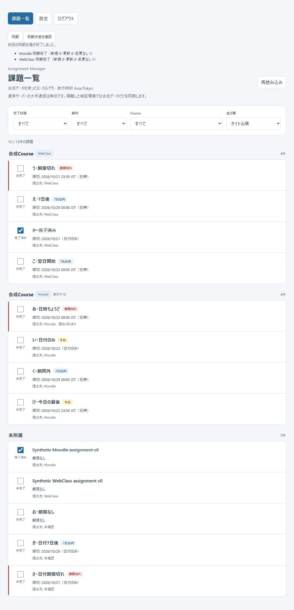
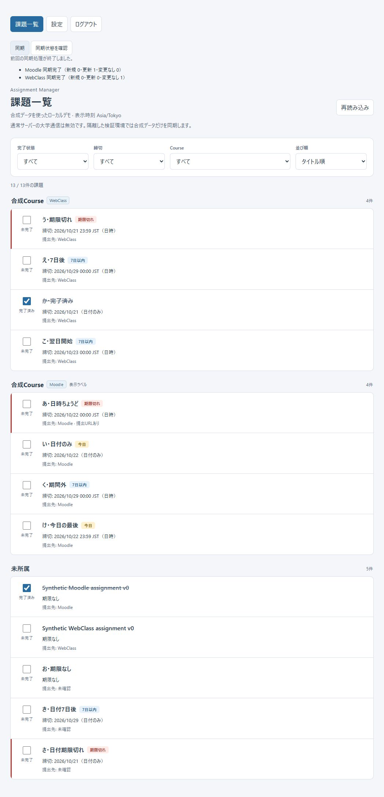
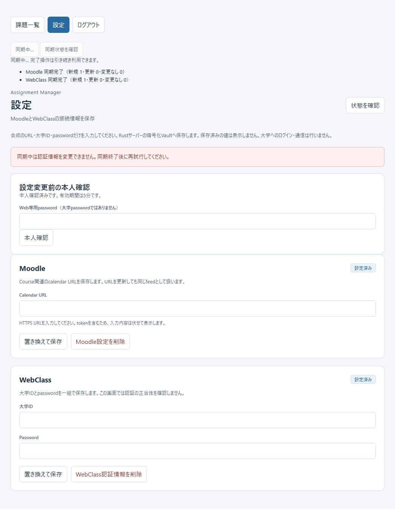
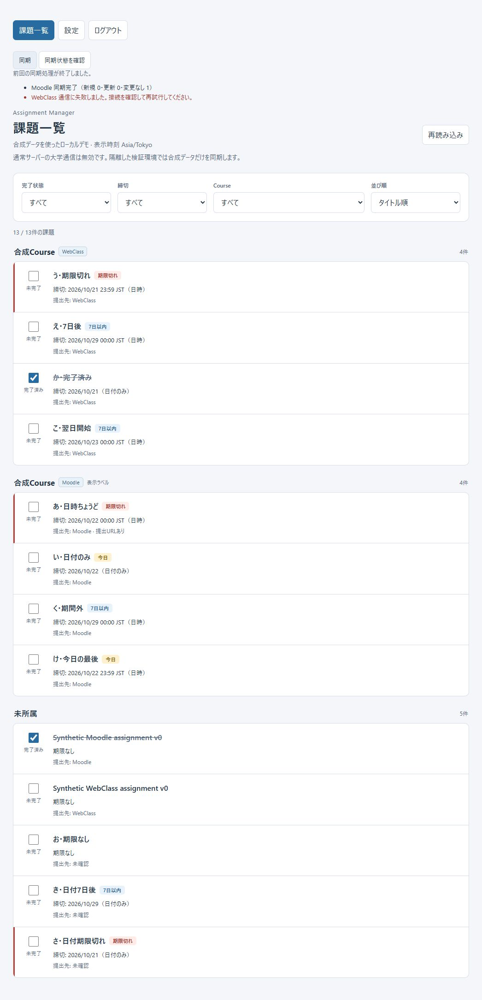
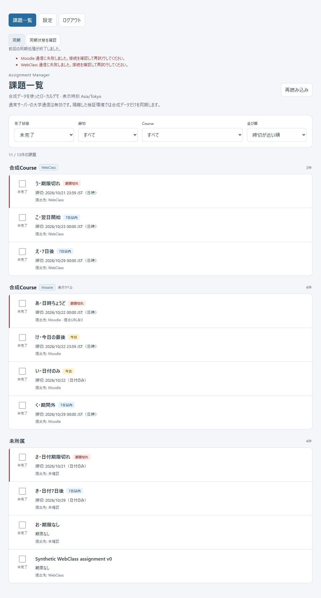
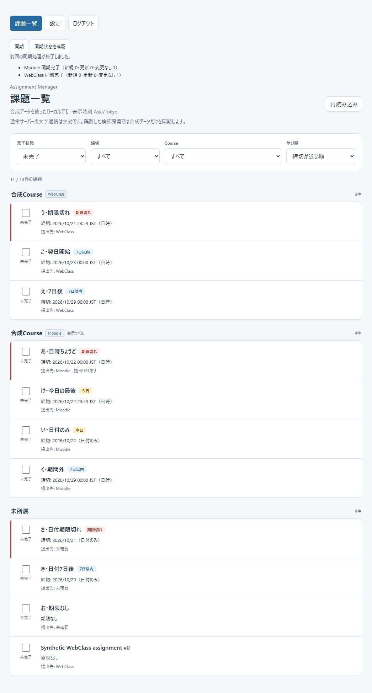

# Phase Web-4A〜4B3: Windows Final Verification

2026-10-22（Asia/Tokyo）、20:18〜20:31。Repository: toppoun/assignment-manager。

**判定: Ready — Web-4AのWindows gateは全必須項目PASS。**
**Web-4B3 Preflightの実大学接続gateは独立してBLOCKEDを維持する。**
新機能、Web-4B3A、実大学へのHTTP/DNS、実credential、public bind、commit/pushは行っていない。

## 1. Git HEAD / scope

- Branch: `feature/web-migration`
- 検証HEAD: `ea384dfac97eec1c37523a7f59e94829fcd8eaea`
- Commit subject: `Web-4B3: 実大学同期の事前検証と合成HTTPS E2Eを実装`
- 開始時: `git status --short --branch`はclean、origin同branchを追跡。
- 終了時もHEADは同じ。変更は本報告、Web-4A追補、Browser証跡画像のみ。

指定されたWeb-4A/4B1/4B2/4B3-PREFLIGHT、Web README、sync_browser_smoke example、
sync_http testsを確認し、通常起動が`DisabledNetworkBackend`のままであることも確認した。
通常Web binaryから同期を試す方法は使っていない。

## 2. Windows toolchain

| 項目 | 確認値 |
| --- | --- |
| OS | Windows x64、25H2、build 26200.9711（NT 10.0.26200） |
| Rust | rustc 1.97.1、`8bab26f4f`、2026-07-14、LLVM 22.1.6 |
| Cargo | cargo 1.97.1、`c980f4866`、2026-06-30 |
| Host / installed target | `x86_64-pc-windows-msvc` |
| Active toolchain | `stable-x86_64-pc-windows-msvc` |
| Visual Studio build tools | 17.14.37516.0、MSVC toolset 14.44.35207 |
| Node | v24.12.0 |
| Browser | Windows上のCodex内蔵Chromium、2 tabs |

OS buildはregistryと`Environment.OSVersion`で確認した。
`Get-ComputerInfo`はsandbox内CIMアクセス拒否のため使用できなかった。
別OS用targetでのcross buildではなく、Windows MSVC host上の実buildである。

## 3. Build / tests / fmt / clippy

| 対象 | Windows結果 | fmt --check | clippy |
| --- | --- | --- | --- |
| Tauri custom-protocol build | PASS、dev profile、exit 0 | PASS | PASS |
| Web all-features | 61 tests PASS、0 doctests、Windows OS-store test 1 ignoredは別実行 | PASS | PASS |
| Web default | 49 tests PASS、0 doctests、同OS-store test 1 ignoredは別実行 | 同manifest | 同manifest |
| core default | 346 tests + 11 doctests PASS | PASS | PASS |
| core all-features lib | 346 tests PASS | 同manifest | 同manifest |
| application | 34 tests + 3 doctests PASS | PASS | PASS |
| macos-bridge Rust | 18 tests PASS、0 doctests | PASS | PASS |
| Tauri Rust tests（補助） | 18 tests PASS、binary-only | 同manifest | 同manifest |
| frontend | `node --test`: 76 tests PASS、0 fail/skip/cancel | — | — |
| Windows KeyProvider明示smoke | 1 test PASS、後述 | — | — |

clippyは全5 manifestで`--all-targets --all-features -- -D warnings`を実行した。
Web all-featuresの内訳はunit15 / auth11 / HTTP15 / secured HTTPS4 / settings7 / sync9。
Mac報告の62件との差1件は`#[cfg(not(windows))]`のnon-Windows VaultUnavailable testであり、
Windowsでの未実行必須項目ではない。Windows KeyProvider smokeを別途実行した。

実行command（repository root / PowerShell）:

```powershell
cargo build --manifest-path src-tauri/Cargo.toml --locked --features custom-protocol
cargo test --manifest-path crates/web-server/Cargo.toml --locked --all-features
cargo test --manifest-path crates/web-server/Cargo.toml --locked
cargo test --manifest-path crates/application/Cargo.toml --locked
cargo test --locked
cargo test --manifest-path crates/macos-bridge/Cargo.toml --locked
node --test

# 補助回帰
cargo test --manifest-path src-tauri/Cargo.toml --locked
cargo test --locked --all-features --lib
cargo test --manifest-path crates/web-server/Cargo.toml --locked --offline windows_key_persists -- --ignored

# 各manifestで両方を実行
$manifests = @(
  'Cargo.toml',
  'crates/application/Cargo.toml',
  'crates/web-server/Cargo.toml',
  'src-tauri/Cargo.toml',
  'crates/macos-bridge/Cargo.toml'
)
foreach ($manifest in $manifests) {
  cargo fmt --manifest-path $manifest --check
  cargo clippy --manifest-path $manifest --locked --all-targets --all-features -- -D warnings
}
```

初回sandbox内ではWeb testsの一時DB初期化が`Internal`で失敗し、coreの一部HTTP fixtureも失敗した。
その実行は中断し、Webとcoreを通常Windows権限で再実行したところ全suiteがPASSした。
applicationは初回からPASS。その他tests/checksも上表の最終成功を確認した。
失敗・中断をPASSに数えていない。アクセス検査、reparse point拒否、認証、Vault、TLS/DNS guardは変更していない。

## 4. Browser smoke environment / procedure

README記載の専用exampleを使用した。固定directoryはrepository rootのtargetではなく、
**`D:\assignment-manager\crates\web-server\target\web-4a-browser-smoke`**である。
開始時このdirectoryは存在せず、今回のbootstrapで合成DB/accountを新規作成した。
対応する専用Windows鍵も明示初期化した。

```powershell
cargo run --manifest-path crates/web-server/Cargo.toml --locked --offline --features synthetic-sync --example sync_browser_smoke -- bootstrap
cargo run --manifest-path crates/web-server/Cargo.toml --locked --offline --features synthetic-sync --example sync_browser_smoke -- init-vault-key
cargo run --manifest-path crates/web-server/Cargo.toml --locked --offline --features synthetic-sync --example sync_browser_smoke -- serve paced
# 停止後、同じ専用DB/鍵で順に再起動
cargo run --manifest-path crates/web-server/Cargo.toml --locked --offline --features synthetic-sync --example sync_browser_smoke -- serve webclass-partial
cargo run --manifest-path crates/web-server/Cargo.toml --locked --offline --features synthetic-sync --example sync_browser_smoke -- serve both-failure
```

Browser URLは`http://127.0.0.1:3000/`だけ。
Web loginは`synthetic-smoke`、bootstrapにはexampleの公開値`synthetic-web-only-password-4a`を非表示入力した。
Settingsは公開mock定数`https://example.invalid/synthetic-calendar`、
`synthetic-student` / `synthetic-university-password`だけを使用した。
これらは実大学に対する認証能力を持たない検証専用値である。

通常`crates/web-server/target/web-poc`、既存Windows Web Vault、Tauri/native DB・credential・鍵は変更していない。
今回新設した専用smoke DBとその対応鍵は再現用に保持した。既存DB/鍵は削除していない。
別途のWindows KeyProvider testは一意な一時entryを作成し、そのtest内で削除した。

## 5. Windows Browser smoke — 19 / 19 PASS

| # | 検証 | 結果・証拠 |
| --- | --- | --- |
| 1 | Login | PASS。synthetic accountで認証成功、logout後の画面消去と再loginも確認 |
| 2 | Synthetic Moodle/WebClass Settings | PASS。Settings本人確認→両設定保存、「設定済み」表示。保存値を再表示しない |
| 3 | Assignment list | PASS。初期all表示11/11件、Course optionsとAsia/Tokyo表示 |
| 4 | Sync開始 | PASS。両設定後「同期状態を確認」で同期有効化、Browserから開始 |
| 5 | Running表示 | PASS。paced modeで「同期中…」、同期/状態確認ボタン無効、一覧利用継続 |
| 6 | Moodle/WebClass別結果 | PASS。初回両created=1、safeな個別result、一覧11→13件へ自動reload |
| 7 | 課題追加・更新 | PASS。初回2件追加。専用DBのMoodle1件をstale titleに変更し、UIで表示後に同期。updated=1、元v0タイトルへ更新、同じIDと全13件を保持 |
| 8 | 再同期duplicateなし | PASS。両created=0 / updated=0 / unchanged=1、13/13件を保持 |
| 9 | Completion保持 | PASS。Moodle合成課題をBrowserでcompletedにし、通常再同期・タイトル更新・process restart後もchecked/completed |
| 10 | WebClass部分失敗後reload | PASS。WebClass1件をstale titleにして表示。webclass-partial同期後、Moodle成功/WebClass失敗でも手動reloadなしでv0タイトルへ自動更新。commit済み変更と13件を保持 |
| 11 | Both failure表示 | PASS。both-failureでMoodle/WebClass両方に固定の通信失敗message、既存課題保持 |
| 12 | 同時Sync操作 | PASS。Browser開始runのrunning中、別keyの追加POST2件とも202 / 同じrunId。追加jobを作らない |
| 13 | 複数Browser tabからSync | PASS。2 tabの同期を同時操作し、双方running→双方created=1ずつの同じ初回結果。補助HTTP観測でも同じactive run |
| 14 | 同期中Settings変更409 | PASS。Browserで本人確認後の保存拒否message。補助HTTPでMoodle/WebClass × PUT/DELETEの4件すべて409 sync_running |
| 15 | Logout中job継続 | PASS。paced同期操作後logout、再loginでまだrunning、その後両source正常完了。一覧消去と古いpanelの再表示抑止も確認 |
| 16 | Server restart後の状態 | PASS。実process停止/再起動を観測。旧session401、再login後旧run404、running=false / activeRunId=null / lastRun=null。両設定と全13件、Moodle completed保持 |
| 17 | Browser console | PASS。各scenarioと2 tabで確認したwarn/errorは0件 |
| 18 | 127.0.0.1だけlisten | PASS。通常Windows権限のnetstatで127.0.0.1:3000だけを確認。0.0.0.0/[::] listenなし、最終停止後port 3000のlisten消失 |
| 19 | 大学HTTP通信0件 | PASS。MockはHTTP client/authenticatorを構築しない。synthetic tripwire・通常Disabled・secured deny testsがPASS。process接続snapshotもloopbackのみ |

更新表示用stale fixtureは、専用directoryの正確なpath、SYNTHETIC-ONLY marker、
対象の公開合成タイトルが1件だけであることをassertしてからSQLiteのtitleだけを変更した。
production codeやexampleのCLIにrevision切替機能を追加していない。
WebClass部分失敗時はこの変更が同期内でcommitされてから失敗するため、
Browserの一覧がv0へ戻ったことをpartial commit後reloadの証拠とした。

同時要求の補助HTTP観測は別の合成login sessionをmemoryに保持し、
Browserが開始したrunをGETで検出してから追加POST / Settings要求を送った。
観測したrun `3b1f2a92584bdd4e08a936d42354de3ef7221052eff4797994bbd233916b22c7`に
2件とも202でjoinし、Moodle/WebClass各created=1、全13件で終了した。

restartでは最後のterminal runを記憶した別の合成sessionを使い、server停止による接続失敗、
再listen後の旧session401、新規login後の旧run404と空のsync statusをassertした。
これはmemory keyを共有したruntime再openではなく、**WindowsKeyProviderを使った実process間の再起動**である。
scenario変更はjob完了後に行った。PTYのCtrl+C停止はshell側exit 1となったため、
手動終了exit 0の証拠とは扱わない。admission停止とjob/mutation drainはWindowsのdeterministic Rust testsがPASSした。

「大学HTTP 0」はMock構造、deny/tripwire tests、固定fixtureと接続snapshotに基づく。
OS全体・全時間のpacket captureを実施したという意味ではない。

## 6. Browser evidence













## 7. Windows KeyProvider

明示ignored test
`keys::tests::windows_key_persists_across_provider_and_database_reopen_without_overwrite`
を通常Windows権限で実行し、1 PASSを確認した。

testは新しい一時directoryに対応するentryだけを使い、次をassertする。

1. 初期loadはmissingとして失敗する。
2. 明示initで鍵を作り、provider再生成後も同じkey ID/bytesをloadする。
3. 再initで既存鍵を上書きしない。
4. test自身のentryだけを削除し、loadが失敗する。
5. 既存bindingが残る状態でinitを再実行してもreplacement keyを生成しない。

通常Webのserviceは`org.assignmentmanager.web.vault.keys.v1`、accountはcanonical control pathのSHA-256。
実大学ID/token/passwordをOS metadataへ含めず、raw keyや既存entryを列挙・出力していない。
永続Browser smokeでも、このtestとは別の専用path identityを使って両設定を保存し、
process restart後も復号できることを確認した。

## 8. Web-4B1〜4B3 regressions

| 境界 | WindowsでPASSした証拠 |
| --- | --- |
| NetworkPolicy / GuardedResolver | core346 tests内のstrict URL/DNS/SSRF、private混入・rebind・proxy拒否、TLS/hostname/timeout/body制限 |
| SecuredCoreSyncBackend | application実handle、Web sync_httpのsecured deny/tripwire、core secured source matrix / SSO / reauth once |
| Whole-run budgets | request/concurrency/group/course/record/deadline/bytes/Cookie limits、実TLS remaining timeout |
| secured-synthetic | Web all-featuresのsecured_https 4 tests。固定CA/fake DNS/4 loopback peersだけ、real host/policy拡張拒否 |
| HTTP→Vault→TLS→parser/import | source matrix、cached session/revision、AuthExpired once/twice、completion/dedup/runtime reopen/wrong-key拒否 |
| Authentication / Vault | auth11、settings7、unit Vault暗号/AAD/nonce/tamper、owner/CSRF/recent reauth/session/restart |
| Windows key custody | 上記OS-store testと専用Browser serverのprocess restart |
| 通常binary | stateのDisabledNetworkBackend注入を維持、default/all-features双方のdisabled backend回帰PASS |

secured-syntheticは新しい一時DBとmemory鍵、固定synthetic.invalid fixtureだけで実行した。
大学/外部DNSへのfallback、OSへのCA導入、hosts変更、TLS検証緩和、system proxy利用は行っていない。

## 9. Findings / changes

Windows固有の実装不具合は見つからず、Rust/frontend/DB schema/lockfileの修正は不要だった。
今回のtracked変更は報告と証跡のみ。

- sandbox内一時DB/HTTP fixture失敗: 通常Windows権限で再実行して解消。製品securityを変更していない。
- Web default-feature testsは既存の`sync_http.rs`のfeature限定importについてunused import warningを出す。
  testはPASS、要求したall-features clippyはwarningなしでPASS。Windows固有でないため修正していない。
- Browser操作でSettingsへ移動し直すとUIの本人確認が再度必要。本人確認後、409 messageを実際に確認した。
  完了toggle後に未完了filterから行が消える挙動も、all表示でchecked状態を確認して正常と判定した。

生の実行logと今回だけの補助scriptはignored directory `target/windows-verification/`に保存した。
`checks-sandbox.jsonl`は初回失敗、`checks-normal.jsonl`は残りの通常権限実行結果。
Web all-featuresの最終成功logは`web-all-features-normal.log`、application成功は`application.log`。
`browser-concurrency.json`、`browser-restart.json`、`browser-console.json`、
`loopback-listener.log`、`mock-process-connections.json`、`port-closed.log`が補助証拠。
Cookie/CSRF/raw Vault鍵はこれらの証拠logへ保存していない。

## 10. Remaining verification / decision

**Web-4AのWindows必須項目に残る未検証・未解決事項はない。Readyと判定する。**

今回のBrowser対象はWindows上のCodex内蔵Chromium。別のChrome/Edge browser profileは使っていない。
Tauriは指定buildとRust testsまでで、installer配布やnative windowの手動操作は対象外。
macOS Swift/Xcode/native Keychainの再検証はWindowsでは実行していない。

実大学のhost/path/現行SSO/利用条件、実接続専用runtime、Mac Web永続鍵のcustody等は
[Web-4B3 Preflight](PHASE-WEB-4B3-PREFLIGHT.md)の独立した残項目であり、
実大学接続gateは**BLOCKED**のまま。実接続や公開運用の承認にはしない。

検証serverは停止し、port 3000のlisten消失を確認。通常DB/既存鍵を削除せず、commit/pushなし。
